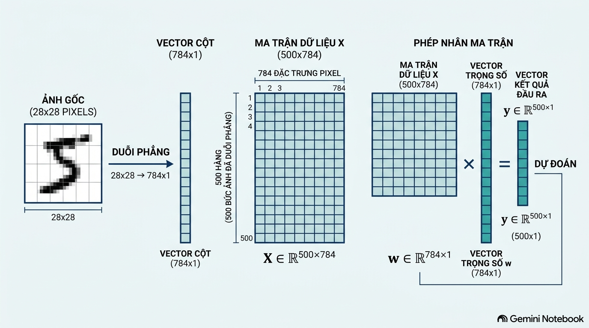

# Liên hệ Vector và Ma trận với Machine Learning trong thực tế

Tài liệu này nối các khái niệm ở Bài 01 với cách dữ liệu thực sự đi qua một hệ thống Machine
Learning. Mục tiêu không phải học thêm nhiều công thức, mà là nhìn một bài toán và trả lời
được ba câu hỏi:

1. Mỗi con số đại diện cho điều gì?
2. Mỗi trục của mảng đại diện cho điều gì?
3. Shape thay đổi như thế nào từ dữ liệu thô đến đầu vào và đầu ra của mô hình?

Tài liệu liên quan: [lý thuyết Bài 01](notes.md) và
[notebook thực hành NumPy](practice.ipynb).

## 1. Tư duy cốt lõi: dữ liệu ML là những mảng có ý nghĩa

Máy tính không trực tiếp hiểu “một căn nhà”, “một bức ảnh” hay “một câu tiếng Việt”. Trước
khi đưa dữ liệu vào mô hình, ta phải mã hóa chúng thành các số và sắp xếp các số đó trong
vector, ma trận hoặc tensor.

| Dữ liệu thực tế | Biểu diễn số | Shape thường gặp |
|---|---|---|
| Một khách hàng có 8 đặc trưng | vector | `(8,)` |
| 10.000 khách hàng, mỗi người 8 đặc trưng | ma trận | `(10000, 8)` |
| Một ảnh xám 28 × 28 pixel | ma trận | `(28, 28)` |
| Một ảnh RGB 224 × 224 pixel | tensor | `(224, 224, 3)` |
| Batch 32 ảnh RGB | tensor | `(32, 224, 224, 3)` |
| Một từ được biểu diễn bởi embedding 768 chiều | vector | `(768,)` |
| 16 câu, mỗi câu 128 token, mỗi token 768 chiều | tensor | `(16, 128, 768)` |

Shape không chỉ cho biết mảng lớn đến đâu. Nó còn mô tả **cấu trúc và ý nghĩa của dữ liệu**.
Nếu đổi nhầm thứ tự trục hoặc làm mất một trục, code đôi khi vẫn chạy nhưng mô hình có thể
học sai hoàn toàn.

## 2. Dữ liệu bảng: dự đoán giá nhà

Giả sử mỗi căn nhà có bốn đặc trưng:

- diện tích;
- số phòng ngủ;
- tuổi của căn nhà;
- khoảng cách đến trung tâm.

Một căn nhà có thể được biểu diễn bằng vector:

$$
\mathbf{x}^{(i)} =
\begin{bmatrix}
120 & 3 & 8 & 4.5
\end{bmatrix}.
$$

Nếu có $N=1.000$ căn nhà và $d=4$ đặc trưng, ta xếp mỗi căn nhà thành một hàng của ma trận:

$$
X\in\mathbb{R}^{1000\times4}.
$$

Vector giá thật có thể có shape `(1000,)`:

$$
y\in\mathbb{R}^{1000}.
$$

Trong NumPy:

```python
X.shape == (1000, 4)  # (samples, features)
y.shape == (1000,)    # một nhãn cho mỗi sample
```

Các thao tác ở Bài 01 xuất hiện trực tiếp trong pipeline:

```python
area = X[:, 0]                     # lấy một đặc trưng, shape (1000,)
first_house = X[0]                 # lấy một mẫu, shape (4,)
feature_means = X.mean(axis=0)     # trung bình từng đặc trưng, shape (4,)
feature_stds = X.std(axis=0)       # độ lệch chuẩn từng đặc trưng, shape (4,)
X_scaled = (X - feature_means) / feature_stds
```

Broadcasting cho phép hai vector `(4,)` được áp dụng lên tất cả 1.000 hàng. Nếu dùng nhầm
`axis=1`, ta sẽ chuẩn hóa các giá trị bên trong từng căn nhà với nhau. Điều đó không có ý
nghĩa vì diện tích, số phòng và khoảng cách là các đại lượng khác đơn vị.

### Liên hệ với mô hình

Một mô hình tuyến tính học một trọng số cho mỗi đặc trưng. Nếu `w.shape == (4,)`, mô hình
sẽ tạo một dự đoán cho mỗi hàng của `X`. Phép tính chi tiết được học ở Bài 02, nhưng ngay từ
bây giờ có thể kiểm tra hợp đồng shape:

```text
X: (1000, 4)
w:       (4,)
----------------
prediction: (1000,)
```

## 3. Ảnh: từ pixel đến ma trận dữ liệu

Một ảnh xám `28 × 28` gồm 784 giá trị pixel. Với mô hình tuyến tính đơn giản, ta có thể
“duỗi phẳng” ảnh thành một vector 784 phần tử. Nếu có 500 ảnh, mỗi vector được đặt thành một
hàng và tạo ra ma trận `X.shape == (500, 784)`.



Trong NumPy:

```python
images = np.zeros((500, 28, 28))
X = images.reshape(500, -1)

assert X.shape == (500, 784)
```

Số `-1` yêu cầu NumPy tự suy ra $28\times28=784$. Số phần tử không đổi:

```python
assert images.size == X.size
```

### Điều gì bị mất khi flatten?

Giá trị pixel không mất, nhưng cấu trúc không gian “pixel nào nằm cạnh pixel nào” không còn
được thể hiện rõ trong shape. Mạng tích chập thường giữ ảnh dưới dạng `(batch, height, width,
channels)` hoặc `(batch, channels, height, width)` để tận dụng cấu trúc này.

Vì vậy, `reshape` có thể đúng về số phần tử nhưng chưa chắc đúng về **ý nghĩa dữ liệu**.

## 4. Văn bản: token và embedding

Mô hình ngôn ngữ thường biến mỗi token thành một vector embedding. Ví dụ, một token được
mã hóa bởi 768 số:

```text
embedding của một token:       (768,)
một câu dài 128 token:          (128, 768)
batch gồm 16 câu:               (16, 128, 768)
```

Ý nghĩa các trục là:

```text
(batch, sequence, embedding)
```

Một lỗi transpose thành `(16, 768, 128)` làm mô hình hiểu nhầm trục embedding và trục vị trí
token. Đây là ví dụ điển hình cho việc các con số vẫn còn nguyên nhưng ý nghĩa đã sai.

Trong một batch, các câu thường có độ dài khác nhau. Hệ thống sẽ thêm padding để chúng có
cùng chiều dài, rồi dùng một boolean mask để đánh dấu vị trí thật và vị trí padding:

```python
token_ids.shape == (16, 128)
attention_mask.shape == (16, 128)
embeddings.shape == (16, 128, 768)
```

Boolean mask trong Bài 01 vì thế không chỉ dùng để lọc bảng dữ liệu; nó cũng là thành phần
quan trọng của các mô hình xử lý ngôn ngữ.

## 5. Mini-batch: tại sao luôn xuất hiện thêm một trục?

Trong huấn luyện thực tế, mô hình hiếm khi xử lý toàn bộ dataset cùng lúc. Dữ liệu được chia
thành các mini-batch để tận dụng phần cứng và giới hạn bộ nhớ.

Ví dụ với ảnh RGB `224 × 224`:

```text
một ảnh:        (224, 224, 3)
batch 32 ảnh:   (32, 224, 224, 3)
                 ↑
                 batch axis
```

Shape `(224, 224, 3)` và `(1, 224, 224, 3)` không tương đương. Shape thứ hai vẫn có trục
batch và cho biết batch hiện chỉ chứa một ảnh. Nhiều API mô hình luôn yêu cầu trục batch,
kể cả khi dự đoán cho đúng một mẫu.

```python
single_image = np.zeros((224, 224, 3))
one_image_batch = single_image[None, ...]

assert one_image_batch.shape == (1, 224, 224, 3)
```

Đây là ứng dụng thực tế của việc thêm trục bằng `None`/`np.newaxis`.

## 6. Pipeline ML thực tế và sự thay đổi shape

Một pipeline dự đoán khách hàng rời bỏ dịch vụ có thể đi qua các bước sau:

| Bước | Biến | Shape ví dụ | Ý nghĩa |
|---|---|---:|---|
| Đọc dữ liệu | `raw_data` | `(12000, 15)` | 12.000 dòng, 15 cột ban đầu |
| Tách feature | `X` | `(12000, 12)` | bỏ ID và cột nhãn |
| Tách nhãn | `y` | `(12000,)` | một nhãn cho mỗi khách hàng |
| Chia train | `X_train` | `(9600, 12)` | dữ liệu dùng để học |
| Chia test | `X_test` | `(2400, 12)` | dữ liệu đánh giá độc lập |
| Chuẩn hóa | `Z_train` | `(9600, 12)` | shape không đổi |
| Tạo mini-batch | `X_batch` | `(64, 12)` | 64 mẫu cho một bước học |
| Dự đoán | `probabilities` | `(64,)` | xác suất cho từng mẫu |

Có ba nguyên tắc quan trọng:

1. Số hàng của `X` phải bằng số phần tử của `y`.
2. Số cột của train và test phải giống nhau và cùng thứ tự đặc trưng.
3. Mean/std phải tính từ train rồi dùng lại cho validation/test, tránh rò rỉ dữ liệu.

Ví dụ:

```python
mu = X_train.mean(axis=0)
sigma = X_train.std(axis=0)

Z_train = (X_train - mu) / sigma
Z_test = (X_test - mu) / sigma
```

Không tính lại `mu` và `sigma` trên test. Test phải mô phỏng dữ liệu mới mà mô hình chưa
được nhìn thấy.

## 7. Những lỗi shape thường gặp trong dự án thật

### Một mẫu bị hiểu thành nhiều mẫu

```python
x.shape            # (12,)
x_batch = x[None]   # (1, 12)
```

Khi API yêu cầu `(batch, features)`, phải thêm trục batch.

### Nhãn `(N,)` và `(N, 1)` bị broadcast ngoài ý muốn

Nếu `prediction.shape == (N,)` nhưng `target.shape == (N, 1)`, phép trừ có thể sinh ra ma
trận `(N, N)` thay vì vector `(N,)`:

```python
prediction = np.zeros(100)      # (100,)
target = np.zeros((100, 1))     # (100, 1)
error = prediction - target     # (100, 100) — thường là sai
```

Đây là lý do `(N,)` và `(N, 1)` không thể được xem là giống nhau.

### Đổi thứ tự trục ảnh sai

```python
# NHWC -> NCHW
images_nchw = images_nhwc.transpose(0, 3, 1, 2)
```

Phải ghi ý nghĩa trục trước khi gọi `transpose`; không nên thử các hoán vị cho đến khi code
hết báo lỗi.

### Sửa dữ liệu gốc qua một view

```python
train_preview = X_train[:10]         # có thể là view
safe_preview = X_train[:10].copy()   # dữ liệu độc lập
```

Nếu chuẩn hóa hoặc thay thế giá trị trên view tại chỗ, dữ liệu gốc có thể bị sửa ngoài ý
muốn.

## 8. Checklist debug shape trong thực tế

Khi pipeline báo lỗi hoặc kết quả bất thường, kiểm tra theo thứ tự:

1. In `shape`, `ndim`, `dtype` ở ranh giới giữa các bước.
2. Viết ý nghĩa từng trục bên cạnh shape, ví dụ `(batch, height, width, channels)`.
3. Kiểm tra index nguyên có vô tình làm mất trục không.
4. Với phép gộp, xác định trục nào phải biến mất.
5. Với broadcasting, căn các shape từ phải sang trái.
6. Kiểm tra số sample của feature và label có bằng nhau không.
7. Kiểm tra train/test có cùng số lượng và thứ tự feature không.
8. Kiểm tra slice có cần `.copy()` trước khi thay đổi tại chỗ không.

Các assertion nhỏ giúp lỗi xuất hiện gần nguyên nhân hơn:

```python
assert X.ndim == 2
assert y.ndim == 1
assert X.shape[0] == y.shape[0]
assert X_train.shape[1] == X_test.shape[1]
assert np.isfinite(X).all()
```

## 9. Bài tập liên hệ

### Bài 1 — Nhận diện shape

Một dataset gồm 20.000 ảnh RGB kích thước `64 × 64`.

1. Shape của toàn bộ dataset theo quy ước channels-last là gì?
2. Shape của một mini-batch 128 ảnh là gì?
3. Nếu flatten ảnh cho mô hình tuyến tính, ma trận mini-batch có shape gì?

### Bài 2 — Tìm lỗi

Một mô hình trả về `prediction.shape == (32,)`, còn nhãn có
`target.shape == (32, 1)`. Hãy dự đoán shape của `prediction - target` và đề xuất cách sửa.

### Bài 3 — Thiết kế biểu diễn

Bạn cần dự đoán điểm thi từ 5 đặc trưng của 2.000 học sinh.

1. Đề xuất shape cho `X` và `y`.
2. Viết cách lấy đặc trưng thứ ba mà vẫn giữ kết quả là ma trận 2D.
3. Viết cách tính trung bình của từng đặc trưng.
4. Giải thích vì sao không nên tính mean/std riêng trên test.

<details>
<summary>Đáp án ngắn</summary>

**Bài 1:** `(20000, 64, 64, 3)`, `(128, 64, 64, 3)`, và
`(128, 12288)` vì $64\times64\times3=12288$.

**Bài 2:** Broadcasting tạo `(32, 32)`. Đưa cả hai về `(32,)`, chẳng hạn
`target = target.reshape(-1)`, hoặc đưa cả hai về `(32, 1)` theo hợp đồng của pipeline.

**Bài 3:** `X.shape == (2000, 5)`, `y.shape == (2000,)`; lấy cột bằng `X[:, 2:3]`; dùng
`X.mean(axis=0)`; thống kê test gây rò rỉ thông tin và không mô phỏng đúng dữ liệu mới.

</details>

## Tổng kết

Vector, ma trận và tensor là ngôn ngữ biểu diễn dữ liệu của Machine Learning:

- vector thường biểu diễn một mẫu, một embedding hoặc một bộ tham số;
- ma trận thường biểu diễn dataset dạng bảng hoặc một batch vector;
- tensor nhiều chiều thường biểu diễn ảnh, video, âm thanh và chuỗi token;
- `reshape`, `transpose`, slicing và broadcasting là các thao tác hằng ngày trong pipeline;
- shape đúng phải đúng cả về kích thước lẫn ý nghĩa của từng trục.

Thói quen quan trọng nhất là luôn đọc shape thành lời. Thay vì chỉ nhìn `(32, 224, 224, 3)`,
hãy đọc: “32 ảnh, cao 224 pixel, rộng 224 pixel và có 3 kênh màu”.
