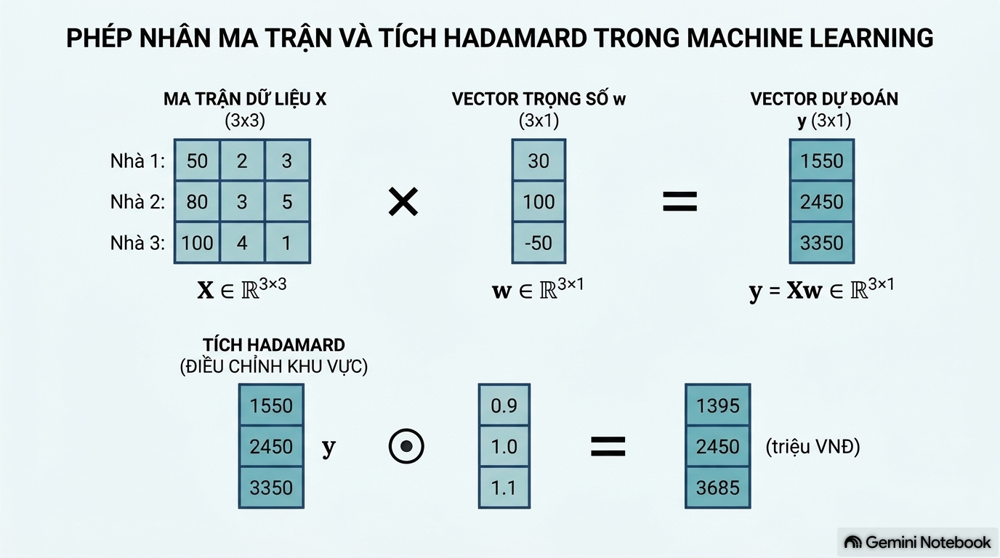

# Liên hệ phép nhân ma trận với Machine Learning trong thực tế

Tài liệu này nối các phép toán ở Bài 02 với một pipeline dự đoán giá nhà. Trọng tâm là hai
phép toán xuất hiện trong hình minh họa:

1. **matrix-vector product** `X @ w` kết hợp các đặc trưng để tạo dự đoán;
2. **tích Hadamard** `y * r` điều chỉnh từng dự đoán bằng một hệ số tương ứng.

Mục tiêu không chỉ là tính ra đúng con số, mà còn đọc được ý nghĩa của từng hàng, từng cột
và từng shape trong một mô hình Machine Learning.

Tài liệu liên quan: [lý thuyết Bài 02](notes.md) và
[notebook thực hành NumPy](practice.ipynb).

## 1. Đọc pipeline từ hình minh họa



Hình mô tả pipeline gồm hai bước:

```text
dữ liệu căn nhà                  giá cơ sở             giá sau điều chỉnh
X (3, 3) @ w (3, 1)       ->     y (3, 1)     ->       y ⊙ r (3, 1)
                                                   hệ số khu vực r (3, 1)
```

Ba hàng của $X$ là ba căn nhà; ba cột là ba đặc trưng của mỗi căn nhà. Hình không ghi tên
cụ thể cho các cột. Để có thể diễn giải bài toán, tài liệu này dùng quy ước:

| Cột | Đặc trưng quy ước | Đơn vị ví dụ |
|---:|---|---|
| 1 | diện tích | $\text{m}^2$ |
| 2 | số phòng ngủ | phòng |
| 3 | tuổi căn nhà | năm |

Với quy ước đó:

$$
X=
\begin{bmatrix}
50&2&3\\
80&3&5\\
100&4&1
\end{bmatrix},
\qquad
\mathbf{w}=
\begin{bmatrix}
30\\100\\-50
\end{bmatrix}.
$$

Mỗi hàng của $X$ phải dùng cùng thứ tự đặc trưng với các phần tử trong $\mathbf{w}$. Nếu
đổi thứ tự cột mà không đổi thứ tự trọng số, phép nhân vẫn chạy nhưng kết quả không còn đúng
ý nghĩa.

## 2. Một căn nhà: dự đoán là một dot product

Hàng đầu tiên là vector đặc trưng của Nhà 1:

$$
\mathbf{x}^{(1)}=
\begin{bmatrix}
50&2&3
\end{bmatrix}.
$$

Giá cơ sở của Nhà 1 là dot product giữa vector đặc trưng và vector trọng số:

$$
\hat y_1
=\mathbf{x}^{(1)}\mathbf{w}
=50\cdot30+2\cdot100+3\cdot(-50)
=1550.
$$

Theo đơn vị trong hình, kết quả là `1550` triệu VNĐ. Hai căn nhà còn lại được tính tương tự:

$$
\begin{aligned}
\hat y_2&=80\cdot30+3\cdot100+5\cdot(-50)=2450,\\
\hat y_3&=100\cdot30+4\cdot100+1\cdot(-50)=3350.
\end{aligned}
$$

Điểm cốt lõi là: **một dự đoán tuyến tính là tổng có trọng số của các đặc trưng**. Dot
product biến một vector có $d$ đặc trưng thành một scalar.

Trong NumPy, có thể dùng vector 1D:

```python
import numpy as np

x = np.array([50.0, 2.0, 3.0])  # (3,)
w = np.array([30.0, 100.0, -50.0])  # (3,)

base_price = x @ w

assert base_price.shape == ()
assert base_price == 1550.0
```

## 3. Nhiều căn nhà: vector hóa bằng phép nhân ma trận

Thay vì viết một vòng lặp để tính từng căn nhà, ta xếp $N$ căn nhà thành $N$ hàng của ma
trận $X\in\mathbb{R}^{N\times d}$. Cùng một vector trọng số được áp dụng cho mọi hàng:

$$
\hat{\mathbf{y}}=X\mathbf{w}.
$$

Với dữ liệu trong hình:

$$
(3,3)@(3,1)\longrightarrow(3,1).
$$

Hai kích thước ở giữa đều bằng `3`, vì số cột đặc trưng của $X$ phải bằng số trọng số.
Kết quả có ba hàng vì cần một dự đoán cho mỗi căn nhà.

```python
X = np.array([
    [50.0, 2.0, 3.0],
    [80.0, 3.0, 5.0],
    [100.0, 4.0, 1.0],
])
w = np.array([30.0, 100.0, -50.0])

y_base = X @ w

assert X.shape == (3, 3)
assert w.shape == (3,)
assert y_base.shape == (3,)
np.testing.assert_allclose(y_base, [1550.0, 2450.0, 3350.0])
```

Code dùng `w.shape == (3,)`, nên kết quả có shape `(3,)`. Nếu muốn biểu diễn đúng dạng
vector cột như trong hình, dùng:

```python
w_col = w[:, None]       # (3, 1)
y_col = X @ w_col        # (3, 1)

assert y_col.shape == (3, 1)
```

Hai kết quả chứa cùng ba giá trị nhưng có shape khác nhau. Pipeline thực tế phải chọn một
quy ước và duy trì nhất quán để tránh broadcasting ngoài ý muốn.

## 4. Trọng số nói gì về mô hình?

Trong mô hình tuyến tính, mỗi trọng số cho biết dự đoán thay đổi bao nhiêu khi đặc trưng
tương ứng tăng một đơn vị và các đặc trưng khác được giữ nguyên.

Theo quy ước đặc trưng ở trên:

- $w_1=30$: tăng thêm $1\,\text{m}^2$ làm giá dự đoán tăng `30` triệu VNĐ;
- $w_2=100$: thêm một phòng ngủ làm giá dự đoán tăng `100` triệu VNĐ;
- $w_3=-50$: căn nhà cũ thêm một năm làm giá dự đoán giảm `50` triệu VNĐ.

Dấu của trọng số mô tả chiều tác động trong mô hình, không tự động chứng minh quan hệ nhân
quả trong thế giới thật. Các đặc trưng có thể tương quan với nhau, dữ liệu có thể thiên lệch,
và quan hệ thực tế có thể không tuyến tính.

### Trọng số đến từ đâu?

Trong hình, $\mathbf{w}$ đã được cho trước để minh họa bước dự đoán. Trong một dự án thật,
các trọng số thường được học từ dữ liệu huấn luyện bằng cách giảm một hàm mất mát. Ví dụ,
với giá thật $\mathbf{y}$ và dự đoán $\hat{\mathbf{y}}=X\mathbf{w}$, mean squared error là:

$$
\operatorname{MSE}
=\frac{1}{N}\sum_{i=1}^{N}(\hat y_i-y_i)^2.
$$

Phép nhân ma trận tạo dự đoán; quá trình tối ưu điều chỉnh $\mathbf{w}$ để dự đoán gần nhãn
huấn luyện hơn. Vì vậy, hình minh họa **inference** với trọng số đã có, chưa mô tả toàn bộ
quá trình training.

## 5. Bias: mức giá nền của mô hình

Một linear layer trong thực tế thường có thêm bias $b$:

$$
\hat{\mathbf{y}}=X\mathbf{w}+b.
$$

Với `X.shape == (N, d)`, `w.shape == (d,)` và scalar `b`, NumPy broadcast cùng một bias
cho cả $N$ căn nhà:

```python
b = 200.0
y_with_bias = X @ w + b

np.testing.assert_allclose(y_with_bias, [1750.0, 2650.0, 3550.0])
```

Bias là giá trị mô hình dự đoán khi tất cả đặc trưng bằng zero. Nó giúp siêu phẳng dự đoán
không bị ép phải đi qua gốc tọa độ. Ý nghĩa thực tế của $b$ còn phụ thuộc cách mã hóa và
chuẩn hóa đặc trưng.

## 6. Tích Hadamard: điều chỉnh riêng từng dự đoán

Sau khi tính giá cơ sở, hình dùng các hệ số khu vực:

$$
\mathbf{r}=
\begin{bmatrix}
0.9\\1.0\\1.1
\end{bmatrix}.
$$

Mỗi căn nhà có đúng một hệ số tương ứng. Giá sau điều chỉnh là tích Hadamard:

$$
\hat{\mathbf{y}}_{\text{adjusted}}
=\hat{\mathbf{y}}\odot\mathbf{r}
=
\begin{bmatrix}
1550\\2450\\3350
\end{bmatrix}
\odot
\begin{bmatrix}
0.9\\1.0\\1.1
\end{bmatrix}
=
\begin{bmatrix}
1395\\2450\\3685
\end{bmatrix}.
$$

Trong NumPy, tích Hadamard dùng `*`:

```python
region_factor = np.array([0.9, 1.0, 1.1])
y_adjusted = y_base * region_factor

assert region_factor.shape == (3,)
assert y_adjusted.shape == (3,)
np.testing.assert_allclose(y_adjusted, [1395.0, 2450.0, 3685.0])
```

Đây là phép nhân từng vị trí:

```text
dự đoán Nhà 1 × hệ số Nhà 1
dự đoán Nhà 2 × hệ số Nhà 2
dự đoán Nhà 3 × hệ số Nhà 3
```

Hệ số khu vực có thể là một quy tắc nghiệp vụ sau mô hình. Một cách khác là mã hóa khu vực
thành feature để mô hình học ảnh hưởng của nó từ dữ liệu. Hai cách có giả định khác nhau:
nhân hệ số sau dự đoán áp đặt trực tiếp tỷ lệ điều chỉnh, còn đưa khu vực vào feature để mô
hình tự ước lượng ảnh hưởng.

## 7. Vì sao bước đầu dùng `@`, bước sau dùng `*`?

Hai phép nhân giải quyết hai bài toán khác nhau:

| Bước | NumPy | Ý nghĩa | Shape trong hình |
|---|---|---|---|
| Kết hợp feature | `X @ w` | lấy dot product mỗi hàng với trọng số | `(3, 3) @ (3,) -> (3,)` |
| Điều chỉnh từng mẫu | `y * r` | ghép từng dự đoán với hệ số cùng vị trí | `(3,) * (3,) -> (3,)` |

`X @ w` có phép cộng dồn trên trục feature:

$$
\hat y_i=\sum_{j=1}^{d}X_{ij}w_j.
$$

`y * r` không cộng dồn:

$$
(\mathbf{y}\odot\mathbf{r})_i=y_i r_i.
$$

Viết `X * w` sẽ nhân từng cột với một trọng số và cho ra ma trận `(N, d)`. Kết quả đó có
thể hữu ích nếu muốn xem **đóng góp riêng của từng feature**, nhưng nó chưa phải vector dự
đoán:

```python
feature_contributions = X * w       # (3, 3)
y_from_contributions = feature_contributions.sum(axis=1)  # (3,)

np.testing.assert_allclose(y_from_contributions, X @ w)
```

Đẳng thức trên cũng cho thấy trực giác của matrix-vector product: nhân từng feature với
trọng số của nó, rồi cộng các đóng góp theo từng hàng.

## 8. Mở rộng sang nhiều đầu ra và mini-batch

Nếu cần dự đoán đồng thời $h$ đại lượng, thay vector $\mathbf{w}$ bằng ma trận trọng số
$W\in\mathbb{R}^{d\times h}$:

$$
Z=XW+B.
$$

Shape của một batch là:

```text
X: (N, d)   # N mẫu, d đặc trưng
W: (d, h)   # h bộ trọng số
b:    (h,)  # một bias cho mỗi đầu ra
Z: (N, h)   # h đầu ra cho mỗi mẫu
```

Ví dụ, một mạng phân loại ba khu vực từ 20 đặc trưng có thể dùng:

```text
X: (64, 20)
W: (20, 3)
b: (3,)
logits = X @ W + b  -> (64, 3)
```

Đây chính là linear layer. Phép toán không thay đổi khi batch lớn hơn; chỉ kích thước $N$
thay đổi.

## 9. Ví dụ NumPy hoàn chỉnh

```python
import numpy as np

# Mỗi hàng: (diện tích, số phòng ngủ, tuổi căn nhà)
X = np.array([
    [50.0, 2.0, 3.0],
    [80.0, 3.0, 5.0],
    [100.0, 4.0, 1.0],
])
w = np.array([30.0, 100.0, -50.0])
region_factor = np.array([0.9, 1.0, 1.1])

assert X.ndim == 2
assert w.shape == (X.shape[1],)
assert region_factor.shape == (X.shape[0],)

y_base = X @ w
y_adjusted = y_base * region_factor

np.testing.assert_allclose(y_base, [1550.0, 2450.0, 3350.0])
np.testing.assert_allclose(y_adjusted, [1395.0, 2450.0, 3685.0])
```

Luồng shape nên được đọc thành lời:

```text
3 căn nhà × 3 feature
@ 3 trọng số
= 3 giá cơ sở
× 3 hệ số khu vực
= 3 giá sau điều chỉnh
```

## 10. Những lỗi dễ gặp trong pipeline thực tế

### Thứ tự feature không khớp với trọng số

Nếu lúc training dùng `(diện tích, số phòng, tuổi nhà)` nhưng lúc inference truyền
`(tuổi nhà, diện tích, số phòng)`, shape vẫn đúng và code vẫn chạy. Dự đoán sai vì ý nghĩa
các cột đã đổi. Pipeline cần lưu cả tên và thứ tự feature, không chỉ lưu mảng số.

### Nhầm `(N,)` với `(N, 1)`

```python
y_base.shape                 # (3,)
region_factor[:, None].shape # (3, 1)

wrong = y_base * region_factor[:, None]
assert wrong.shape == (3, 3)
```

Broadcasting ghép mọi dự đoán với mọi hệ số và tạo ma trận `(3, 3)`. Để nhân từng cặp, hai
đối tượng phải cùng quy ước: đều `(N,)` hoặc đều `(N, 1)`.

### Quên kiểm tra số feature

```python
assert X.ndim == 2
assert w.ndim == 1
assert X.shape[1] == w.shape[0]
```

Assertion giúp lỗi xuất hiện ngay tại ranh giới dữ liệu thay vì sâu bên trong pipeline.

### So sánh feature khác đơn vị bằng độ lớn trọng số

Một trọng số `100` không nhất thiết “quan trọng hơn” trọng số `30`, vì một phòng ngủ và một
mét vuông có đơn vị cũng như thang đo khác nhau. Chuẩn hóa feature có thể giúp tối ưu ổn
định hơn, nhưng cũng thay đổi cách diễn giải trực tiếp của trọng số.

### Xem hệ số điều chỉnh như chân lý

Các hệ số `0.9`, `1.0`, `1.1` trong hình chỉ minh họa phép Hadamard. Trong ứng dụng thật,
chúng phải có nguồn hợp lệ, được kiểm thử trên dữ liệu chưa thấy và được theo dõi khi thị
trường thay đổi.

## 11. Checklist debug phép nhân trong thực tế

Khi pipeline báo lỗi hoặc cho kết quả bất thường, kiểm tra theo thứ tự:

1. In `shape`, `ndim` và `dtype` của mọi đầu vào tại ranh giới giữa các bước.
2. Ghi ý nghĩa từng trục, ví dụ `X: (samples, features)` và `W: (features, outputs)`.
3. Xác định ý định của phép toán: dùng `@` để kết hợp feature hay dùng `*` để ghép từng
   phần tử với một hệ số tương ứng.
4. Với `@`, kiểm tra hai kích thước ở giữa có bằng nhau và dự đoán shape đầu ra trước khi
   chạy code.
5. Kiểm tra vector đang là `(d,)`, `(1, d)` hay `(d, 1)`; không xem ba shape này là tương
   đương.
6. Với `*` và phép cộng bias, căn các shape từ phải sang trái để kiểm tra broadcasting.
7. Kiểm tra số mẫu có khớp giữa dự đoán và hệ số điều chỉnh hay không.
8. Kiểm tra tên, thứ tự và đơn vị feature lúc inference có giống lúc training không.
9. Không đổi thứ tự nhân, `reshape` hoặc chuyển vị chỉ để làm lỗi biến mất; mỗi thay đổi
   phải đúng với ý nghĩa dữ liệu.
10. Kiểm tra đầu ra hữu hạn và đối chiếu ít nhất một hàng bằng phép tính tay.

Các assertion nhỏ giúp lỗi xuất hiện gần nguyên nhân hơn:

```python
assert X.ndim == 2
assert w.ndim == 1
assert X.shape[1] == w.shape[0]
assert region_factor.ndim == 1
assert X.shape[0] == region_factor.shape[0]

y_base = X @ w
assert y_base.shape == region_factor.shape
assert np.isfinite(y_base).all()

y_adjusted = y_base * region_factor
assert y_adjusted.shape == (X.shape[0],)
assert np.isfinite(y_adjusted).all()
```

## 12. Bài tập liên hệ

### Bài 1 — Tính dự đoán mới

Một căn nhà có vector feature `(70, 3, 4)`. Dùng vector trọng số trong hình:

1. Tính giá cơ sở bằng tay.
2. Tính giá sau điều chỉnh nếu hệ số khu vực là `1.05`.
3. Cho biết shape NumPy của kết quả nếu `x` và `w` đều là vector 1D.

### Bài 2 — Suy luận shape

Một batch có `X.shape == (128, 12)`, mô hình có `W.shape == (12, 4)` và
`b.shape == (4,)`.

1. Shape của `X @ W` là gì?
2. Shape của `X @ W + b` là gì?
3. `b` được broadcast qua trục nào?

### Bài 3 — Tìm lỗi broadcasting

Cho `prediction.shape == (128,)` và `factor.shape == (128, 1)`.

1. Shape của `prediction * factor` là gì?
2. Đưa ra hai cách sửa để phép nhân chỉ tạo 128 kết quả.

### Bài 4 — Chọn phép toán

Chọn `@` hoặc `*` cho mỗi trường hợp:

1. Kết hợp 20 feature với một vector 20 trọng số.
2. Áp một sample weight cho mỗi giá trị loss trong batch.
3. Tính mọi đầu ra của linear layer từ ma trận dữ liệu và ma trận trọng số.
4. Nhân từng pixel ảnh với một mask cùng shape.

<details>
<summary>Đáp án ngắn</summary>

**Bài 1:** $70\cdot30+3\cdot100+4\cdot(-50)=2200$ triệu VNĐ; sau điều chỉnh là
$2200\cdot1.05=2310$ triệu VNĐ; kết quả của `x @ w` là scalar NumPy có shape `()`.

**Bài 2:** `(128, 4)` cho cả hai biểu thức; bias được broadcast qua trục batch, tức áp cùng
vector bốn bias cho 128 hàng.

**Bài 3:** Kết quả sai có shape `(128, 128)`. Có thể đưa `factor` về `(128,)` bằng
`factor.reshape(-1)`, hoặc đưa `prediction` về `(128, 1)` bằng `prediction[:, None]`.

**Bài 4:** `@`, `*`, `@`, `*`.

</details>

## Tổng kết

Ví dụ giá nhà trong hình gói gọn hai mẫu tính toán phổ biến của Machine Learning:

- `X @ w` lấy dot product giữa mỗi mẫu và một bộ trọng số để tạo dự đoán;
- shape `(N, d) @ (d,) -> (N,)` giữ trục mẫu và gộp trục feature;
- `y * r` dùng tích Hadamard để ghép từng dự đoán với một hệ số tương ứng;
- matrix product có bước cộng dồn, còn Hadamard product chỉ nhân theo từng vị trí;
- shape đúng chưa đủ: thứ tự feature, đơn vị và ý nghĩa của từng trục cũng phải đúng;
- trong dự án thật, trọng số được học từ dữ liệu và mọi quy tắc điều chỉnh đều cần được
  đánh giá trên dữ liệu chưa thấy.

Khi gặp một phép nhân trong code ML, hãy hỏi: “Ta đang kết hợp feature để tạo đầu ra, hay
đang ghép từng phần tử với một hệ số tương ứng?” Câu trả lời thường quyết định phải dùng
`@` hay `*`.
