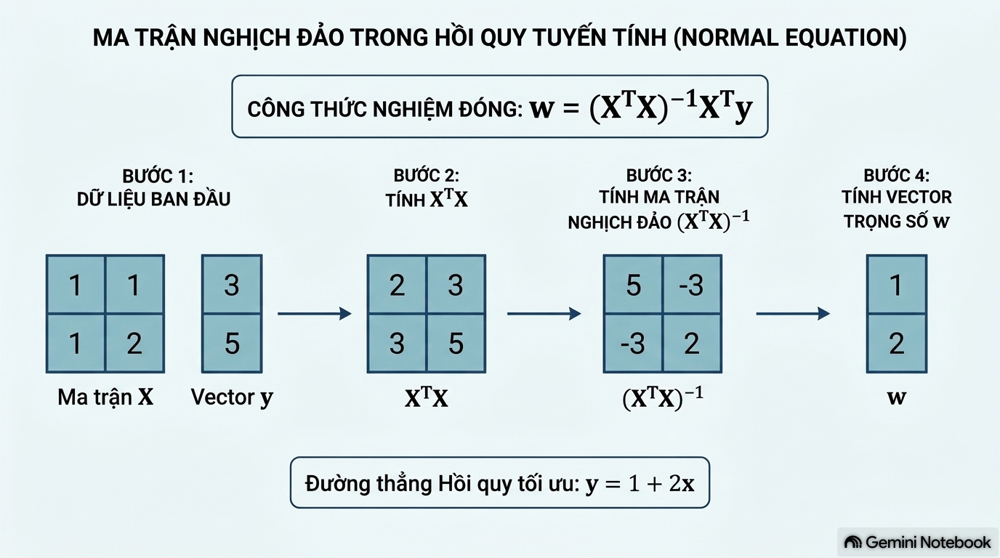

# Liên hệ nghịch đảo và ma trận đặc biệt với Machine Learning trong thực tế

Tài liệu này nối Bài 03 với bài toán hồi quy tuyến tính. Trọng tâm không phải là “tính được
ma trận nghịch đảo”, mà là chọn cách giải hệ phù hợp, nhận ra khi dữ liệu làm hệ suy biến và
hiểu cách các ma trận đặc biệt xuất hiện trong một pipeline ML.

Tài liệu liên quan: [lý thuyết Bài 03](notes.md) và
[notebook thực hành NumPy](practice.ipynb).

## 1. Đọc pipeline hồi quy từ hình minh họa



Hình minh họa công thức normal equation:

$$
\mathbf{w}=(X^TX)^{-1}X^T\mathbf{y}.
$$

Với hai điểm dữ liệu $(x,y)=(1,3)$ và $(2,5)$, ta thêm một cột toàn số 1 để học intercept:

$$
X=
\begin{bmatrix}
1&1\\
1&2
\end{bmatrix},
\qquad
\mathbf{y}=
\begin{bmatrix}
3\\5
\end{bmatrix}.
$$

Cột đầu tiên ứng với hệ số chặn $w_0$; cột thứ hai ứng với slope $w_1$. Mô hình là:

$$
\hat y=w_0+w_1x.
$$

Các shape trong hình:

```text
X:          (2, 2)   # 2 mẫu, 2 tham số gồm intercept
y:          (2,)     # 1 nhãn cho mỗi mẫu
X.T @ X:    (2, 2)   # Gram matrix
X.T @ y:    (2,)     # vế phải
w:          (2,)     # intercept và slope
```

Ta có:

$$
X^TX=
\begin{bmatrix}
2&3\\3&5
\end{bmatrix},
\qquad
(X^TX)^{-1}=
\begin{bmatrix}
5&-3\\-3&2
\end{bmatrix},
$$

và kết quả:

$$
\mathbf{w}=
\begin{bmatrix}1\\2\end{bmatrix}.
$$

Do đó đường thẳng đi qua hai điểm là $\hat y=1+2x$.

## 2. Normal equation đến từ đâu?

Hồi quy tuyến tính chọn $\mathbf{w}$ để giảm tổng bình phương sai số:

$$
L(\mathbf{w})=\|X\mathbf{w}-\mathbf{y}\|_2^2.
$$

Đặt gradient bằng 0 dẫn đến:

$$
X^TX\mathbf{w}=X^T\mathbf{y}.
$$

Đây là một hệ tuyến tính theo $\mathbf{w}$. Nếu $X^TX$ khả nghịch, ta có thể viết nghiệm
trên giấy dưới dạng:

$$
\mathbf{w}=(X^TX)^{-1}X^T\mathbf{y}.
$$

Nhưng công thức toán học không bắt buộc code phải tạo nghịch đảo. Trong NumPy, bản dịch tốt
hơn là:

```python
gram = X.T @ X
rhs = X.T @ y
w = np.linalg.solve(gram, rhs)
```

Ta đang giải `gram @ w = rhs`. `solve` cho biết đúng ý định, tránh tạo nghịch đảo trung gian
và thường ổn định hơn `np.linalg.inv(gram) @ rhs`.

## 3. Vì sao `X.T @ X` là ma trận đặc biệt?

Gram matrix $G=X^TX$ luôn đối xứng:

$$
G^T=(X^TX)^T=X^TX=G.
$$

Mỗi phần tử $G_{ij}$ là dot product giữa cột feature $i$ và feature $j$:

$$
G_{ij}=\mathbf{x}_i^T\mathbf{x}_j.
$$

- Phần tử trên đường chéo đo bình phương độ lớn của từng feature.
- Phần tử ngoài đường chéo đo mức hai feature biến thiên cùng nhau theo dot product.
- Hai feature phụ thuộc tuyến tính làm $G$ suy biến.

Trong code:

```python
gram = X.T @ X
assert gram.shape == (X.shape[1], X.shape[1])
assert np.allclose(gram, gram.T)
```

Nếu `X.shape == (N, d)`, Gram matrix có shape `(d, d)`: kích thước phụ thuộc số feature,
không phụ thuộc trực tiếp số sample.

## 4. Cách triển khai nên dùng trong thực tế

Có ba cách thường gặp, nhưng không ngang nhau về độ ổn định.

### Cách 1 — Nghịch đảo tường minh: dùng để minh họa, không ưu tiên

```python
w_inverse = np.linalg.inv(X.T @ X) @ X.T @ y
```

Cách này bám sát công thức trên giấy, nhưng tạo nghịch đảo không cần thiết và thất bại nếu
$X^TX$ suy biến.

### Cách 2 — Giải normal equation: tốt hơn nghịch đảo

```python
w_solve = np.linalg.solve(X.T @ X, X.T @ y)
```

Cách này phù hợp khi $X^TX$ có điều kiện đủ tốt. Tuy nhiên việc tạo $X^TX$ có thể làm vấn đề
độ điều kiện nghiêm trọng hơn; về trực giác, condition number theo norm 2 bị bình phương.

### Cách 3 — Giải least squares trực tiếp: lựa chọn NumPy mặc định hợp lý

```python
w_lstsq, residuals, rank, singular_values = np.linalg.lstsq(X, y, rcond=None)
```

`lstsq` giải trực tiếp bài toán $\min_w\|Xw-y\|_2^2$, hỗ trợ ma trận chữ nhật và xử lý tốt
hơn khi feature phụ thuộc hoặc gần phụ thuộc. Nó còn trả về rank và singular values để chẩn
đoán dữ liệu.

| Cách | Khi phù hợp | Hạn chế chính |
|---|---|---|
| `inv(X.T @ X) @ X.T @ y` | minh họa công thức với dữ liệu nhỏ | tạo nghịch đảo; dễ mất ổn định |
| `solve(X.T @ X, X.T @ y)` | hệ vuông, đủ điều kiện tốt | vẫn tạo normal equation |
| `lstsq(X, y)` | hồi quy tuyến tính tổng quát | không biểu diễn trực tiếp normal equation |

Trong dự án thật, đừng chọn nghịch đảo chỉ vì công thức trong sách có ký hiệu $^{-1}$.

## 5. Khi normal equation thất bại: feature phụ thuộc

Giả sử dataset có hai feature:

- diện tích tính bằng $\text{m}^2$;
- cùng diện tích tính bằng square feet.

Hai cột chỉ khác nhau bởi một hệ số đổi đơn vị, nên một cột là bội của cột kia. Mô hình
không thể xác định duy nhất đóng góp của từng feature. `X.T @ X` sẽ suy biến.

Ví dụ đơn giản:

```python
x1 = np.array([1.0, 2.0, 3.0, 4.0])
x2 = 2.0 * x1
X_collinear = np.column_stack([np.ones(4), x1, x2])

gram = X_collinear.T @ X_collinear
```

`solve(gram, rhs)` có thể báo `LinAlgError`, còn `lstsq` vẫn trả về một nghiệm least-squares
có norm nhỏ nhất trong số các nghiệm tương đương:

```python
w, _, rank, _ = np.linalg.lstsq(X_collinear, y, rcond=None)
assert rank < X_collinear.shape[1]
```

Đây không chỉ là lỗi kỹ thuật. Nó cho biết thiết kế feature có thông tin dư thừa và các hệ
số riêng lẻ không còn được xác định duy nhất.

## 6. Gần suy biến: code vẫn chạy nhưng trọng số không ổn định

Khó hơn trường hợp suy biến là hai feature gần như trùng nhau. Khi đó `solve` có thể vẫn chạy,
nhưng một thay đổi rất nhỏ trong dữ liệu làm trọng số đổi mạnh.

```python
x2 = x1 + 1e-8 * noise
X_near = np.column_stack([np.ones_like(x1), x1, x2])

condition_X = np.linalg.cond(X_near)
condition_gram = np.linalg.cond(X_near.T @ X_near)
```

Hai trọng số lớn trái dấu có thể triệt tiêu nhau để cho dự đoán có vẻ hợp lý. Vì vậy cần xem
cả ba thứ:

1. chất lượng dự đoán/phần dư;
2. condition number hoặc singular values;
3. độ ổn định của hệ số khi dữ liệu thay đổi nhẹ.

Chuẩn hóa feature giúp khi vấn đề đến từ khác biệt đơn vị, nhưng không loại bỏ được phụ thuộc
tuyến tính thật sự.

## 7. Ridge regression: ma trận đơn vị tạo regularization

Ridge regression thêm phạt bình phương độ lớn trọng số:

$$
\|X\mathbf{w}-\mathbf{y}\|_2^2
+\lambda\|\mathbf{w}\|_2^2.
$$

Hệ normal equation trở thành:

$$
(X^TX+\lambda I)\mathbf{w}=X^T\mathbf{y},
$$

nên có thể tính:

```python
d = X.shape[1]
ridge_matrix = X.T @ X + lambda_ * np.eye(d)
w_ridge = np.linalg.solve(ridge_matrix, X.T @ y)
```

$\lambda I$ cộng $\lambda$ vào đường chéo, làm các hướng “yếu” bớt gần suy biến và kéo các
trọng số về 0. Đây là ứng dụng trực tiếp của identity matrix.

Nếu cột đầu là intercept, nhiều quy ước không regularize hệ số này:

```python
penalty = np.eye(d)
penalty[0, 0] = 0.0
w_ridge = np.linalg.solve(X.T @ X + lambda_ * penalty, X.T @ y)
```

Việc có regularize intercept hay không là lựa chọn mô hình; cần ghi rõ thay vì vô tình áp
dụng theo code.

## 8. Ma trận chéo trong scaling và weighted least squares

Ma trận chéo biểu diễn các phép biến đổi độc lập theo từng tọa độ.

### Scale từng feature

Với vector scale $s\in\mathbb{R}^d$:

$$
XD
$$

với $D=\operatorname{diag}(s)$ sẽ nhân cột $j$ của $X$ với $s_j$. Trong NumPy, broadcasting
thường gọn hơn:

```python
X_scaled = X * scales
np.testing.assert_allclose(X_scaled, X @ np.diag(scales))
```

### Gán trọng số cho từng sample

Weighted least squares giảm:

$$
(Xw-y)^T W(Xw-y),
$$

trong đó $W=\operatorname{diag}(\alpha_1,\ldots,\alpha_N)$ chứa độ quan trọng của từng mẫu.
Normal equation là:

$$
(X^TWX)w=X^TWy.
$$

Trong code, không cần tạo ma trận `(N, N)`:

```python
weighted_X = sample_weights[:, None] * X
gram_weighted = X.T @ weighted_X
rhs_weighted = X.T @ (sample_weights * y)
w_weighted = np.linalg.solve(gram_weighted, rhs_weighted)
```

Broadcasting tiết kiệm bộ nhớ và làm rõ rằng mỗi hàng/mẫu nhận một trọng số.

## 9. Ma trận hoán vị và việc shuffle dataset

Trong SGD, dữ liệu thường được shuffle trước mỗi epoch. Nếu $P$ là permutation matrix:

$$
X_{\text{shuffled}}=PX,
\qquad
y_{\text{shuffled}}=Py.
$$

Điều quan trọng là dùng **cùng một phép hoán vị** để mỗi hàng feature vẫn đi với đúng label.
Trong NumPy nên dùng index thay vì tạo $P$:

```python
order = rng.permutation(X.shape[0])
X_shuffled = X[order]
y_shuffled = y[order]
```

Shuffle riêng hai lần là một lỗi nghiêm trọng nhưng khó phát hiện bằng shape:

```python
# Sai: hai permutation độc lập phá vỡ cặp X-y
X_bad = X[rng.permutation(len(X))]
y_bad = y[rng.permutation(len(y))]
```

Một lần nữa, shape đúng không bảo đảm ý nghĩa dữ liệu đúng.

## 10. Ma trận tam giác trong quá trình giải hệ

Các thư viện số không nhất thiết tính nghịch đảo theo công thức đóng. Chúng thường phân rã
ma trận rồi giải các hệ tam giác bằng thế tiến/thế lùi.

Với một số ma trận đối xứng xác định dương, Cholesky cho:

$$
A=LL^T,
$$

trong đó $L$ là tam giác dưới. Hệ $Ax=b$ được tách thành:

$$
Lz=b,
\qquad
L^Tx=z.
$$

Ý nghĩa thực hành: cấu trúc “đối xứng”, “tam giác” không chỉ để phân loại. Nó cho phép thuật
toán nhanh và ổn định hơn. Phân rã Cholesky sẽ được học kỹ ở Bài 11.

## 11. Ví dụ NumPy hoàn chỉnh: fit đường thẳng

```python
import numpy as np

x = np.array([1.0, 2.0])
y = np.array([3.0, 5.0])
X = np.column_stack([np.ones_like(x), x])

assert X.shape == (2, 2)
assert y.shape == (2,)

gram = X.T @ X
rhs = X.T @ y

w_solve = np.linalg.solve(gram, rhs)
w_lstsq, _, rank, singular_values = np.linalg.lstsq(X, y, rcond=None)

predictions = X @ w_solve
residual = predictions - y

np.testing.assert_allclose(w_solve, [1.0, 2.0])
np.testing.assert_allclose(w_solve, w_lstsq)
np.testing.assert_allclose(predictions, y)
assert rank == 2
assert np.linalg.norm(residual) < 1e-12
```

Luồng dữ liệu:

```text
x (2,) --thêm cột 1--> X (2, 2)
X.T @ X ----------------> Gram (2, 2), đối xứng
X.T @ y ----------------> rhs (2,)
solve(Gram, rhs) --------> w (2,)
X @ w -------------------> prediction (2,)
```

Ví dụ chỉ có hai điểm nên mô hình hai tham số khớp chính xác. Với dữ liệu thật có nhiễu,
phần dư thường khác 0 và `lstsq` tìm đường thẳng có tổng bình phương sai số nhỏ nhất.

## 12. Những lỗi dễ gặp trong pipeline thực tế

### Dùng `inv` vì thấy ký hiệu $^{-1}$ trong công thức

Ký hiệu toán học mô tả nghiệm; nó không quy định thuật toán. Ưu tiên `solve` hoặc `lstsq`.

### Quên cột intercept

`X` chỉ chứa feature gốc sẽ ép mô hình đi qua gốc tọa độ. Thêm cột 1 nếu muốn học intercept,
hoặc quản lý bias riêng và nhất quán.

### Nhầm sample weights với feature weights

Sample weights có shape `(N,)` và scale các hàng; feature scales có shape `(d,)` và scale các
cột. Broadcasting sai trục có thể chạy nhưng thay đổi bài toán.

### Chỉ kiểm tra training residual

Residual nhỏ không cho biết mô hình tổng quát tốt, không phát hiện data leakage và không bảo
đảm hệ số ổn định. Vẫn cần validation/test độc lập.

### Bỏ qua rank và condition number

Nghiệm có thể tồn tại nhưng hệ số rất nhạy. Kiểm tra feature dư thừa, scale và regularization.

### Regularize cả intercept ngoài ý muốn

Nếu cột đầu là toàn số 1, `lambda_ * np.eye(d)` cũng phạt intercept. Hãy quyết định rõ quy
ước và tạo penalty matrix tương ứng.

### Shuffle feature và label bằng hai permutation

Shape vẫn đúng nhưng quan hệ đầu vào–nhãn bị phá hủy. Luôn tái sử dụng cùng `order`.

## 13. Checklist debug hồi quy tuyến tính

1. Kiểm tra `X.ndim == 2`, `y.ndim == 1` và `X.shape[0] == y.shape[0]`.
2. Xác nhận cột intercept có hay không và thứ tự feature nhất quán.
3. Kiểm tra mọi giá trị hữu hạn bằng `np.isfinite`.
4. Với normal equation, xác nhận Gram matrix đối xứng và có shape `(d, d)`.
5. Ưu tiên `lstsq(X, y)`; chỉ dùng `solve` khi hệ vuông phù hợp.
6. Xem `rank`, singular values hoặc condition number nếu hệ số bất thường.
7. Tính prediction, residual và metric trên cả train lẫn validation/test.
8. Nếu dùng Ridge, kiểm tra penalty matrix và cách xử lý intercept.
9. Nếu shuffle, dùng đúng một permutation cho tất cả mảng theo trục sample.

## 14. Bài tập liên hệ

### Bài 1 — Đọc shape

Cho `X.shape == (500, 12)` và `y.shape == (500,)`.

1. Shape của `X.T @ X`, `X.T @ y` và `w` là gì?
2. Identity trong Ridge phải có shape nào?
3. Prediction `X @ w` có shape nào?

### Bài 2 — Chọn thuật toán

Chọn giữa `inv`, `solve`, `lstsq` và giải thích:

1. minh họa công thức nghịch đảo cho ma trận $2\times2$;
2. giải hệ vuông khả nghịch $A(50,50)x=b$;
3. fit hồi quy với `X.shape == (1000, 20)`;
4. fit khi hai feature trùng nhau.

### Bài 3 — Tìm lỗi shuffle

Giải thích vì sao đoạn code sau làm hỏng dataset và viết lại:

```python
X = X[rng.permutation(len(X))]
y = y[rng.permutation(len(y))]
```

### Bài 4 — Ridge không phạt intercept

Với `X.shape == (N, 5)` và cột đầu là intercept, hãy tạo penalty matrix để chỉ regularize
bốn hệ số còn lại, rồi viết phép `solve` hoàn chỉnh.

### Bài 5 — Weighted least squares không tạo ma trận lớn

Với `sample_weights.shape == (N,)`, hãy tạo $X^TWX$ và $X^TWy$ bằng broadcasting, không tạo
`W.shape == (N, N)`.

## Tổng kết

- Nghiệm đóng của hồi quy tuyến tính dẫn đến hệ $(X^TX)w=X^Ty$.
- Trong code, `solve` tốt hơn nghịch đảo tường minh; `lstsq` thường là lựa chọn trực tiếp và
  ổn định hơn cho hồi quy tổng quát.
- $X^TX$ là Gram matrix đối xứng; feature phụ thuộc làm nó suy biến hoặc gần suy biến.
- Ridge thêm $\lambda I$ để regularize và cải thiện độ ổn định của hệ.
- Ma trận chéo biểu diễn scaling/weights, ma trận hoán vị biểu diễn shuffle, còn ma trận tam
  giác xuất hiện bên trong các thuật toán giải hệ.
- Shape đúng là chưa đủ: phải giữ đúng ý nghĩa feature, label, intercept và thứ tự sample.
