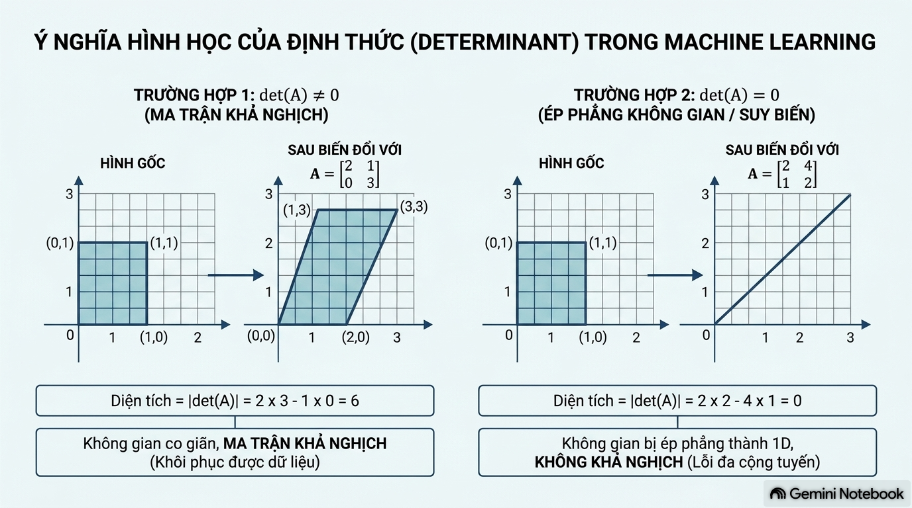

# Liên hệ định thức với Machine Learning trong thực tế

Tài liệu này nối Bài 04 với ba câu hỏi thực tế trong ML:

1. Một phép biến đổi feature làm dữ liệu giãn, co hay mất chiều như thế nào?
2. Vì sao covariance determinant xuất hiện trong Gaussian likelihood?
3. Vì sao mô hình đổi biến phải cộng hoặc trừ một log-determinant?

Tài liệu liên quan: [lý thuyết Bài 04](notes.md) và
[notebook thực hành NumPy](practice.ipynb).

## 1. Đọc ý nghĩa hình học từ hình minh họa



Hình minh họa hai tình huống của phép biến đổi tuyến tính
$\mathbf{x}\mapsto A\mathbf{x}$.

### Trường hợp khả nghịch

Với

$$
A=
\begin{bmatrix}
2&1\\0&3
\end{bmatrix},
$$

ta có:

$$
\det(A)=2\cdot3-1\cdot0=6.
$$

Hình vuông đơn vị diện tích 1 được biến thành hình bình hành diện tích 6. Không gian vẫn còn
đủ hai chiều và phép biến đổi có thể được hoàn tác.

### Trường hợp suy biến

Với

$$
B=
\begin{bmatrix}
2&4\\1&2
\end{bmatrix},
$$

cột thứ hai bằng hai lần cột thứ nhất, nên:

$$
\det(B)=2\cdot2-4\cdot1=0.
$$

Hình vuông bị ép thành một đoạn thẳng: diện tích từ 1 trở thành 0. Nhiều điểm đầu vào khác
nhau bị ánh xạ tới cùng đầu ra, nên không thể khôi phục dữ liệu duy nhất.

Trong ML, hiện tượng này xuất hiện khi feature transformation loại bỏ một chiều, khi các
feature phụ thuộc tuyến tính hoặc khi covariance suy biến.

## 2. Feature transformation: determinant đo mức thay đổi thể tích

Giả sử mỗi mẫu có hai feature và ta áp dụng:

$$
\mathbf{z}=A\mathbf{x}.
$$

Nếu dữ liệu được lưu theo hàng trong `X.shape == (N, 2)`, công thức NumPy tương ứng là:

```python
Z = X @ A.T
```

Ta dùng `A.T` vì mỗi hàng của `X` là $\mathbf{x}^T$:

$$
\mathbf{z}^T=\mathbf{x}^TA^T.
$$

Diện tích một vùng feature sau biến đổi được nhân với $|\det(A)|$.

| Determinant | Ý nghĩa với vùng feature |
|---:|---|
| `4.0` | diện tích tăng 4 lần, orientation giữ nguyên |
| `0.25` | diện tích còn một phần tư |
| `-2.0` | diện tích tăng 2 lần và orientation bị đảo |
| `0.0` | vùng bị ép xuống số chiều thấp hơn |

Determinant chỉ cho biết **tổng thay đổi thể tích**, không nói đầy đủ từng hướng bị biến đổi
ra sao. Hai ma trận có cùng determinant vẫn có thể kéo dãn/nén các hướng rất khác nhau.

## 3. Mất thông tin và đa cộng tuyến

Giả sử ta tạo hai feature mới:

$$
\begin{aligned}
z_1&=x_1+2x_2,\\
z_2&=2x_1+4x_2.
\end{aligned}
$$

Feature thứ hai luôn bằng hai lần feature thứ nhất. Ma trận biến đổi là:

$$
A=
\begin{bmatrix}
1&2\\2&4
\end{bmatrix},
\qquad
\det(A)=0.
$$

Dù đầu ra vẫn có hai cột, dữ liệu chỉ còn một chiều thông tin. Shape `(N, 2)` không phát hiện
được điều này.

Hệ quả trong hồi quy tuyến tính:

- các hệ số không được xác định duy nhất;
- $X^TX$ có thể suy biến;
- nghiệm normal equation bằng `solve` có thể thất bại;
- hệ số có thể cực kỳ nhạy nếu hai feature chỉ gần phụ thuộc.

Trong code, determinant giúp xây trực giác nhưng chẩn đoán thực tế nên dùng rank, singular
values và condition number:

```python
rank = np.linalg.matrix_rank(X)
condition = np.linalg.cond(X)
```

Không dùng `np.linalg.det(X.T @ X) == 0` làm tiêu chuẩn duy nhất.

## 4. Determinant không đo đầy đủ độ ổn định

Xét hai ma trận:

$$
A=10^{-6}I_2,
\qquad
B=
\begin{bmatrix}
10^6&0\\0&10^{-6}
\end{bmatrix}.
$$

Ta có:

$$
\det(A)=10^{-12},
\qquad
\det(B)=1.
$$

`A` có determinant rất nhỏ nhưng condition number bằng 1: mọi hướng được scale đồng đều.
`B` có determinant bằng 1 nhưng condition number bằng $10^{12}$: một hướng bị kéo rất mạnh,
hướng kia bị nén rất mạnh.

Vì vậy:

- determinant đo thay đổi **tổng thể tích**;
- condition number đo mức **bất cân bằng và nhạy sai số giữa các hướng**.

Hai đại lượng trả lời hai câu hỏi khác nhau.

## 5. Covariance determinant: thể tích phân tán của dữ liệu

Với dữ liệu $d$ chiều, covariance matrix $\Sigma\in\mathbb{R}^{d\times d}$ mô tả mức phân
tán và tương quan giữa các feature. $\det(\Sigma)$ đôi khi được gọi là generalized variance.

Trong hai chiều, các đường đồng mật độ Gaussian là ellipse. Diện tích ellipse cùng mức tỷ lệ
với:

$$
\sqrt{\det(\Sigma)}.
$$

- determinant lớn: ellipse chiếm vùng rộng;
- determinant nhỏ: dữ liệu tập trung trong vùng hẹp;
- determinant 0: ellipse bị ép thành đoạn thẳng, covariance suy biến.

Nếu các feature có đơn vị khác nhau, determinant covariance cũng mang đơn vị và phụ thuộc
scale. Vì vậy không so sánh determinant giữa các biểu diễn khác đơn vị mà không chuẩn hóa hoặc
hiểu rõ ngữ cảnh.

## 6. Gaussian log-likelihood và `logdet`

Với Gaussian $d$ chiều:

$$
p(\mathbf{x})
=\frac{1}{(2\pi)^{d/2}\det(\Sigma)^{1/2}}
\exp\left(
-\frac12(\mathbf{x}-\mu)^T\Sigma^{-1}(\mathbf{x}-\mu)
\right).
$$

Lấy log:

$$
\log p(\mathbf{x})
=-\frac12\left[
d\log(2\pi)
+\log\det(\Sigma)
+(\mathbf{x}-\mu)^T\Sigma^{-1}(\mathbf{x}-\mu)
\right].
$$

Hai thành phần có vai trò khác nhau:

- Mahalanobis term đo điểm cách mean bao xa theo hình học covariance;
- log-determinant điều chỉnh cho tổng thể tích phân phối, bảo đảm density được chuẩn hóa.

Trong NumPy, triển khai ổn định:

```python
sign, logdet = np.linalg.slogdet(covariance)
if sign <= 0:
    raise ValueError("Covariance phải có determinant dương")

delta = x - mean
solved = np.linalg.solve(covariance, delta)
mahalanobis_sq = delta @ solved

log_density = -0.5 * (
    d * np.log(2.0 * np.pi) + logdet + mahalanobis_sq
)
```

Không cần tạo `inv(covariance)`.

## 7. Vì sao dùng `slogdet` thay cho `log(det(A))`?

Determinant là tích của nhiều hệ số scale. Trong số chiều lớn, tích này có thể quá lớn hoặc
quá nhỏ so với phạm vi floating point.

Ví dụ ma trận chéo $1000\times1000$ có mọi phần tử đường chéo bằng 10:

$$
\det(A)=10^{1000},
$$

vượt xa `float64`. `np.linalg.det(A)` có thể trả `inf`, nhưng:

$$
\log|\det(A)|=1000\log 10
$$

vẫn là một số hữu hạn.

```python
sign, logabsdet = np.linalg.slogdet(A)
```

`slogdet` lưu riêng dấu và log magnitude nên phù hợp với likelihood, loss và các phép so sánh
trong log-space.

## 8. Gaussian classifier: determinant ảnh hưởng dự đoán

Một Gaussian classifier có thể mô hình hóa mỗi lớp bằng mean và covariance riêng:

$$
p(x\mid y=k)=\mathcal{N}(x;\mu_k,\Sigma_k).
$$

Ta dự đoán lớp có log-posterior lớn nhất:

$$
\hat y
=\arg\max_k
\left[
\log p(x\mid y=k)+\log p(y=k)
\right].
$$

Nếu hai lớp có cùng khoảng cách Mahalanobis tới một điểm nhưng covariance determinant khác
nhau, lớp có phân phối rộng hơn phải “trải” cùng tổng xác suất trên thể tích lớn hơn và có
density cục bộ thấp hơn. Log-determinant tạo ra hiệu chỉnh này.

Đây là nền tảng của Quadratic Discriminant Analysis (QDA). Nếu mọi lớp dùng cùng covariance,
phần log-determinant giống nhau và ranh giới quyết định trở thành tuyến tính như LDA.

## 9. Regularization covariance

Khi số mẫu ít hơn số feature hoặc feature phụ thuộc, sample covariance có thể suy biến:

$$
\det(\Sigma)=0.
$$

Một kỹ thuật cơ bản là thêm một số dương nhỏ vào đường chéo:

$$
\Sigma_{\text{reg}}=\Sigma+\lambda I.
$$

Trong code:

```python
regularized_cov = covariance + lambda_ * np.eye(covariance.shape[0])
```

Điều này làm các phương sai theo mọi hướng ít nhất bằng một mức dương, giúp `slogdet` và
`solve` ổn định hơn. Đây là cùng motif với Ridge ở Bài 03.

$\lambda$ không nên được chọn chỉ để hết lỗi; nó thay đổi mô hình và cần được xem như một
hyperparameter.

## 10. Jacobian determinant và phép đổi biến

Giả sử biến ngẫu nhiên $x$ được biến đổi thành:

$$
y=f(x).
$$

Nếu $f$ kéo giãn một vùng lên 10 lần, mật độ trong vùng đó phải giảm 10 lần để tổng xác suất
vẫn bằng 1. Với biến đổi tuyến tính $y=Ax$:

$$
p_Y(y)
=p_X(A^{-1}y)\frac{1}{|\det(A)|}.
$$

Trong log-space:

$$
\log p_Y(y)
=\log p_X(x)-\log|\det(A)|.
$$

Với biến đổi phi tuyến, $A$ được thay bởi Jacobian cục bộ $J_f(x)$:

$$
\log p_Y(y)
=\log p_X(x)-\log|\det J_f(x)|.
$$

Normalizing flows thiết kế các phép biến đổi khả nghịch có log-determinant tính được hiệu quả,
nhờ đó biến một phân phối đơn giản thành phân phối phức tạp mà vẫn tính được likelihood.

## 11. Determinant trong lựa chọn dữ liệu và feature

Một ứng dụng nâng cao là tối đa hóa determinant của một information matrix hoặc covariance
matrix. Trực giác: chọn các quan sát/feature làm thể tích không gian thông tin lớn, tránh các
hướng bị trùng lặp.

Trong experimental design, D-optimality thường tối đa hóa:

$$
\det(X^TX)
$$

hoặc tương đương tối đa hóa `logdet`. Tuy nhiên, đây không phải quy tắc chọn feature phổ quát:
determinant nhạy với scale, đơn vị và preprocessing. Thực tế cần chuẩn hóa và kết hợp với mục
tiêu dự đoán.

## 12. Ví dụ NumPy hoàn chỉnh: log-density Gaussian

```python
import numpy as np

mean = np.array([0.0, 1.0])
covariance = np.array([
    [2.0, 0.6],
    [0.6, 1.0],
])
points = np.array([
    [0.0, 1.0],
    [1.0, 1.5],
    [3.0, -1.0],
])

sign, logdet = np.linalg.slogdet(covariance)
assert sign > 0

centered = points - mean
solved = np.linalg.solve(covariance, centered.T).T
mahalanobis_sq = np.sum(centered * solved, axis=1)

d = mean.size
log_density = -0.5 * (
    d * np.log(2.0 * np.pi) + logdet + mahalanobis_sq
)

assert log_density.shape == (3,)
assert np.argmax(log_density) == 0
```

Luồng shape:

```text
points:                  (N, d)
mean:                       (d,)
centered:                (N, d)
covariance:              (d, d)
solve(cov, centered.T):  (d, N)
mahalanobis_sq:              (N,)
log_density:                 (N,)
```

`solve` nhận nhiều vế phải: mỗi cột của `centered.T` là vector độ lệch của một điểm.

## 13. Những lỗi dễ gặp trong pipeline thực tế

### Xem determinant bằng 0 như một phép kiểm tra số hoàn hảo

Trong floating point, hãy dùng rank, condition number và cách giải phù hợp. Determinant chủ
yếu cung cấp ý nghĩa đại số/hình học và log-volume.

### Bỏ qua dấu khi cần orientation

`abs(det)` đủ cho volume nhưng làm mất thông tin phản xạ. `slogdet` giữ cả `sign` và
`logabsdet`.

### Dùng determinant để thay thế singular values

Determinant là tích hiệu ứng trên mọi hướng; các hướng lớn và nhỏ có thể triệt tiêu về tích.
Nó không cho biết hướng nào gây bất ổn.

### Tính nghịch đảo covariance

Dùng `solve(covariance, delta)` cho Mahalanobis term, không dùng `inv(covariance) @ delta`.

### Quên regularize covariance khi dữ liệu ít

Với $N\le d$ hoặc feature phụ thuộc, sample covariance thường không full-rank. Thêm diagonal
regularization và đánh giá hyperparameter.

### So sánh generalized variance khác đơn vị

Scale feature thay đổi determinant covariance theo lũy thừa. Chỉ so sánh sau khi quy ước
feature/đơn vị nhất quán.

### Dùng `log(det(A))` khi determinant âm

Log của số âm không phải số thực. Nếu cần log absolute determinant, dùng `slogdet`; nếu ma
trận phải xác định dương như covariance, dấu không dương là tín hiệu cần xử lý.

## 14. Checklist debug ứng dụng determinant

1. Kiểm tra hai trục cuối của mảng là ma trận vuông.
2. Xác định cần signed determinant, absolute determinant hay log-absolute-determinant.
3. Nếu cần log, dùng `slogdet` và kiểm tra `sign`.
4. Với covariance, kiểm tra symmetry, giá trị hữu hạn và diagonal regularization.
5. Dùng `solve` cho quadratic/Mahalanobis term.
6. Không suy luận condition number chỉ từ magnitude của determinant.
7. Kiểm tra feature scale và đơn vị trước khi so sánh volume.
8. Với batch, xác nhận `det` gộp đúng hai trục cuối và giữ các batch axis.
9. Với phép đổi biến, kiểm tra dấu cộng/trừ của log-determinant theo chiều biến đổi.

## 15. Bài tập liên hệ

### Bài 1 — Feature transformation

Cho:

$$
A=\begin{bmatrix}3&0\\0&-2\end{bmatrix}.
$$

1. Diện tích bị thay đổi bao nhiêu lần?
2. Orientation có đổi không?
3. Nếu vùng ban đầu có diện tích 5, diện tích mới là bao nhiêu?

### Bài 2 — Determinant và condition number

Tạo hai ma trận đường chéo:

```python
A = np.diag([1e-6, 1e-6])
B = np.diag([1e6, 1e-6])
```

So sánh determinant và condition number. Giải thích vì sao determinant nhỏ hơn không nhất
thiết đồng nghĩa điều kiện xấu hơn.

### Bài 3 — Covariance suy biến

Một dataset có feature thứ hai bằng đúng ba lần feature thứ nhất. Dự đoán rank và determinant
của covariance. Đề xuất cách xử lý khi cần fit Gaussian density.

### Bài 4 — Viết Gaussian log-density

Viết hàm nhận `points(N, d)`, `mean(d,)`, `covariance(d, d)` và trả `log_density(N,)`. Chỉ
dùng `slogdet` và `solve`, không dùng `det` hoặc `inv`.

### Bài 5 — Đổi biến

Nếu $x$ có density `0.2` tại một điểm và $y=Ax$ với $|\det(A)|=4$, density tương ứng của
$y$ là bao nhiêu? Giải thích bằng bảo toàn xác suất.

## Tổng kết

- $|\det(A)|$ đo hệ số co giãn thể tích; dấu cho biết orientation có bị đảo không.
- Determinant 0 nghĩa là phép biến đổi làm mất ít nhất một chiều thông tin.
- Determinant không thay thế rank, singular values hoặc condition number khi chẩn đoán số.
- Covariance determinant đo generalized variance và xuất hiện trong hệ số chuẩn hóa Gaussian.
- `slogdet` là công cụ phù hợp cho likelihood và log-volume; `solve` phù hợp cho Mahalanobis
  term.
- Jacobian log-determinant bảo đảm mật độ xác suất biến đổi đúng khi không gian bị co giãn.
