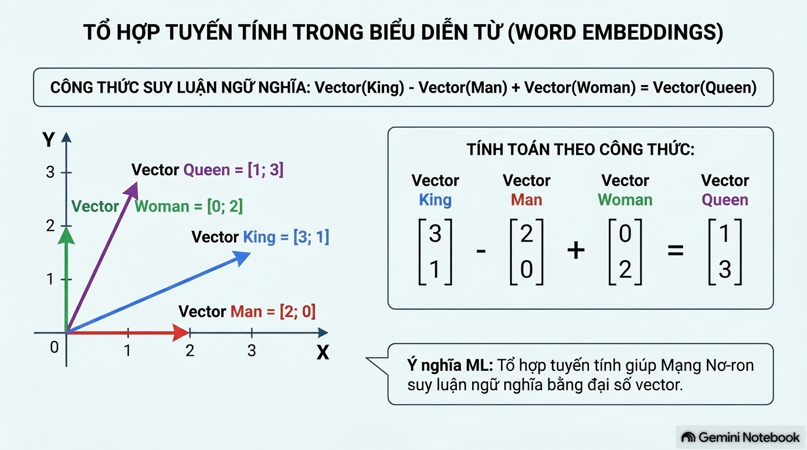

# Liên hệ tổ hợp tuyến tính, span và basis với Machine Learning

Tài liệu này theo dõi một truy vấn embedding từ lúc kết hợp các vector từ đến
lúc tìm ứng viên gần nhất. Sau đó, ta dùng một basis của mặt phẳng để biểu diễn
cùng bảng embedding với ít tọa độ hơn và kiểm tra kết quả truy xuất có được giữ nguyên.

Tài liệu đi kèm gồm [lý thuyết Bài 05](notes.md) và
[notebook thực hành NumPy](practice.ipynb).

## 1. Đọc phép tổ hợp tuyến tính trong hình



Trong hình, bốn từ được gán các vector minh họa hai chiều.

| Từ | Vector |
|---|---|
| `king` | $(3,1)$ |
| `man` | $(2,0)$ |
| `woman` | $(0,2)$ |
| `queen` | $(1,3)$ |

Lấy hiệu giữa `king` và `man` rồi cộng `woman` cho vector truy vấn

$$
q=(3,1)-(2,0)+(0,2)=(1,3).
$$

Đây là tổ hợp tuyến tính của ba vector với hệ số $(1,-1,1)^T$. Trong ví dụ
được dựng sẵn, $q$ khớp đúng với vector `queen`. Với embedding học từ dữ liệu,
phép tính này tạo ra một truy vấn gần đúng. Ứng viên đứng đầu phụ thuộc vào mô hình,
từ vựng, ngữ liệu và thước đo similarity.

## 2. Từ bảng embedding đến vector truy vấn

Giống Bài 01, ta lưu một từ trên mỗi hàng của $E\in\mathbb R^{V\times d}$.
Trong phép tổ hợp, các vector nguồn lại đóng vai trò **cột** của $A\in\mathbb R^{d\times k}$.
Với ba từ nguồn, hai cách dưới đây cho cùng kết quả.

```python
import numpy as np

words = np.array(["king", "man", "woman", "queen", "river", "book"])
E = np.array([
    [3.0, 1.0], [2.0, 0.0], [0.0, 2.0],
    [1.0, 3.0], [-1.0, 1.0], [2.0, 2.0],
])
source_ids = np.array([0, 1, 2])
weights = np.array([1.0, -1.0, 1.0])

A = E[source_ids].T            # (2, 3)
query = A @ weights            # (2,)
query_from_rows = weights @ E[source_ids]

np.testing.assert_allclose(query, query_from_rows)
np.testing.assert_allclose(query, E[3])
```

Span của ba vector nguồn trong ví dụ là $\mathbb R^2$, vì `man` và `woman`
cung cấp hai hướng độc lập. Cả ba vector là một tập sinh có phần tử dư. Ví dụ,
`king` bằng $1.5$ lần `man` cộng $0.5$ lần `woman`. Nếu chọn `man` và `woman`
làm basis, tọa độ của $q$ theo basis này là $(0.5,1.5)^T$.

## 3. Truy xuất từ bằng cosine similarity

Vector truy vấn là một điểm trong không gian liên tục. Để trả về một từ có trong
từ điển, ta xếp hạng các hàng embedding theo cosine similarity đã học ở Bài 02.

$$
s_i=\frac{E_{i,:}\cdot q}{\|E_{i,:}\|_2\|q\|_2}.
$$

Đoạn code dưới tiếp nối ví dụ trên. Ta bỏ các từ nguồn khỏi ứng viên để tìm
một từ mới cho câu hỏi tương tự, đồng thời bỏ hàng zero vì cosine của hàng đó
không xác định. Nếu query bằng zero hoặc tập ứng viên rỗng, hàm báo lỗi.

```python
def cosine_scores(embeddings, query, excluded=()):
    query_norm = np.linalg.norm(query)
    if query_norm == 0:
        raise ValueError("Cosine cần query khác zero.")

    norms = np.linalg.norm(embeddings, axis=1)
    eligible = norms > 0
    eligible[list(excluded)] = False
    if not eligible.any():
        raise ValueError("Cần ít nhất một ứng viên khác zero.")

    scores = np.full(embeddings.shape[0], -np.inf)
    scores[eligible] = (embeddings[eligible] @ query) / (norms[eligible] * query_norm)
    return scores

scores = cosine_scores(E, query, source_ids)
answer = words[np.argmax(scores)]
assert answer == "queen"
```

Các tọa độ trong hình được chọn để dễ tính. Một lần truy xuất đúng trên bộ
minh họa chỉ kiểm tra được pipeline. Khi đánh giá embedding đã học, cần nhiều
truy vấn và xem cả những kết quả sai hoặc phản ánh thiên lệch từ ngữ liệu.

## 4. Nén một bảng embedding nằm trong span thấp chiều

Xét một bảng minh họa có ba tọa độ mỗi từ. Tọa độ thứ ba của mỗi hàng bằng tổng
hai tọa độ đầu. Mọi vector vì vậy nằm trong mặt phẳng $z=x+y$.

Hai cột của $B$ là một basis của mặt phẳng.

$$
B=\begin{bmatrix}1&0\\0&1\\1&1\end{bmatrix}.
$$

Mỗi vector 3D mã hóa thành hai hệ số. Để xử lý cả bảng, xếp các vector thành các
cột của $E_3^T$ rồi giải $BC^T=E_3^T$.

```python
E3 = np.column_stack([E, E.sum(axis=1)])                # (V, 3)
B = np.array([[1.0, 0.0], [0.0, 1.0], [1.0, 1.0]])   # (3, 2)

coordinates_t, _, rank, _ = np.linalg.lstsq(B, E3.T, rcond=None)
coordinates = coordinates_t.T                         # (V, 2)
reconstructed = coordinates @ B.T                     # (V, 3)
errors = np.linalg.norm(reconstructed - E3, axis=1)    # (V,)

assert rank == 2
np.testing.assert_allclose(reconstructed, E3, atol=1e-12)
assert errors.max() < 1e-12
```

| Bước | Shape | Ý nghĩa |
|---|---|---|
| Bảng gốc `E3` | $(V,3)$ | mỗi hàng là một embedding |
| Basis `B` | $(3,2)$ | mỗi cột là một hướng sinh |
| Tọa độ `coordinates` | $(V,2)$ | mỗi hàng là hệ số theo basis |
| Tái tạo `coordinates @ B.T` | $(V,3)$ | trở về không gian tính similarity |

Ở đây phép nén chính xác vì ta cố ý dựng dữ liệu trong một mặt phẳng. Nếu hàng
mới có thêm thành phần ngoài mặt phẳng, `lstsq` cho bản tái tạo gần nhất theo
chuẩn Euclid và phần dư dương. Trong pipeline học basis từ dữ liệu, hãy chọn
basis trên tập train và đo sai số tái tạo trên dữ liệu mới.

## 5. Vì sao cần kiểm tra cosine sau khi đổi tọa độ?

Hai cột của $B$ ở trên có dot product bằng 1. Chúng tạo thành basis nhưng góc giữa
hai cột khác góc giữa hai trục tọa độ $e_1$ và $e_2$. Trong không gian tọa độ 2D,
cosine giữa $e_1=(1,0)^T$ và $e_2=(0,1)^T$ bằng 0. Hai vector 3D tương ứng
$(1,0,1)^T$ và $(0,1,1)^T$ có cosine bằng $1/2$.

Để giữ đúng phép so sánh ban đầu, ta có thể tạo truy vấn bằng tọa độ 2D, tái tạo
truy vấn và các ứng viên về 3D, rồi tính cosine tại đó.

```python
query_coordinates = weights @ coordinates[source_ids]
query3 = B @ query_coordinates
scores3 = cosine_scores(reconstructed, query3, source_ids)

original_query3 = weights @ E3[source_ids]
original_scores3 = cosine_scores(E3, original_query3, source_ids)
np.testing.assert_allclose(query3, original_query3, atol=1e-12)
np.testing.assert_allclose(scores3, original_scores3, atol=1e-12)
assert words[np.argmax(scores3)] == "queen"
```

Phép tổ hợp trước hoặc sau tái tạo cho cùng truy vấn vì $B$ là tuyến tính.
Nếu muốn tính dot product ngay trên tọa độ, công thức giữ nguyên hình học là
$(Bc)^T(Bd)=c^T(B^TB)d$. Khi basis trực chuẩn, $B^TB=I$ và có thể dùng dot
product thông thường trên tọa độ. Bài 07 sẽ làm rõ tính chất này.

## 6. Một liên hệ khác với hồi quy tuyến tính

Trong hồi quy của Bài 03, các feature là cột của $X$. Mọi dự đoán trên $N$ mẫu
có dạng $Xw$, nên đều nằm trong span của các cột. Ví dụ, nếu cột thứ hai bằng
hai lần cột thứ nhất thì $Xw=(w_1+2w_2)X_{:,1}$ với chỉ số toán học bắt đầu từ 1.
Các bộ hệ số $(3,0)^T$ và $(1,1)^T$ tạo cùng dự đoán.

Nếu có intercept, cột toàn 1 bổ sung một hướng khi nó độc lập với các cột
hiện có. Với đích nằm ngoài span của design matrix, `lstsq` chọn dự đoán gần
đích nhất theo tổng bình phương sai số. Nếu các cột phụ thuộc, dự đoán tối ưu
vẫn duy nhất trong span nhưng trọng số tạo ra dự đoán đó có thể có nhiều bộ.

## 7. Checklist debug span và embedding

1. Ghi rõ trục từ, trục feature và vị trí các vector sinh khi lập hệ.
2. Kiểm tra rank so với số cột sinh trước khi gọi một tập là basis.
3. Kiểm tra shape của hệ số và sai số tái tạo trên từng hàng.
4. Chọn ngưỡng phần dư theo scale dữ liệu. Xem lại các hướng gần phụ thuộc khi
   rank thay đổi theo ngưỡng.
5. Khi truy xuất, dùng cùng biểu diễn hình học cho query và ứng viên. Bỏ qua
   vector zero và loại từ nguồn nếu bài toán yêu cầu.
6. Kiểm tra cả kết quả truy xuất và phần dư trên dữ liệu mới nếu giảm chiều.

## 8. Bài tập liên hệ

1. Trong ví dụ hình, tìm tọa độ của `king` và `queen` theo basis gồm `man`, `woman`.
2. Thêm từ mới có embedding $(2,6)$ vào bảng 2D. Cosine của từ đó với $q$ là bao
   nhiêu? Chuyện gì xảy ra khi hai ứng viên đồng hạng?
3. Dùng basis $B$ ở Phần 4 để tái tạo vector $(1,1,3)^T$. Dự đoán phần dư bằng 0
   hay khác 0 trước khi kiểm chứng bằng NumPy.
4. Dùng $B$ để tính cosine của hai vector có tọa độ $(1,0)^T$ và $(0,1)^T$ theo
   hai cách. So sánh cosine trên tọa độ với cosine sau khi tái tạo.
5. Với design matrix $(N,3)$ có cột thứ ba bằng tổng hai cột đầu, cho hai bộ hệ
   số khác nhau tạo cùng dự đoán.

## Tổng kết

- Tổ hợp tuyến tính tạo vector truy vấn. Cosine similarity xếp hạng các ứng viên.
- Span cho biết những vector nào có thể tái tạo. Basis cho mỗi vector trong span
  đúng một bộ tọa độ.
- Phần dư giúp đo mức giữ thông tin. Hình học của basis quyết định cách giữ
  đúng similarity sau khi đổi tọa độ.
