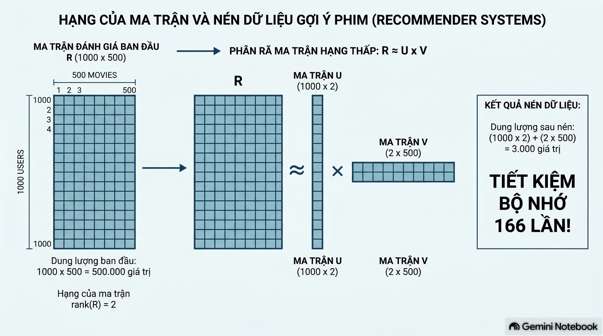

# Liên hệ Range, Null Space và Rank với Machine Learning

Tài liệu này theo dõi cách một hệ gợi ý biểu diễn điểm phim bằng ít chiều hơn,
khôi phục điểm cho các phim và xếp hạng những phim người dùng chưa xem. Từ cùng
một ví dụ, ta xem một quan hệ giữa các cột trở thành vector trong null space
như thế nào và điều gì xảy ra khi một người dùng mới chỉ chấm một phim.

Tài liệu đi kèm gồm [lý thuyết Bài 06](notes.md) và
[notebook thực hành NumPy](practice.ipynb).

## 1. Đọc phép phân rã hạng thấp trong hình



Mỗi hàng của $R\in\mathbb R^{m\times n}$ là một người dùng, mỗi cột là một phim.
Hình dùng $m=1000$, $n=500$ và $k=2$ để minh họa cách xấp xỉ $R\approx UV$.

| Mảng | Shape tổng quát | Shape trong hình | Ý nghĩa |
|---|---|---|---|
| $R$ | $(m,n)$ | $(1000,500)$ | điểm theo cặp người dùng–phim |
| $U$ | $(m,k)$ | $(1000,2)$ | mỗi hàng là một vector người dùng |
| $V$ | $(k,n)$ | $(2,500)$ | mỗi cột là một vector phim |
| $UV$ | $(m,n)$ | $(1000,500)$ | bảng điểm tái tạo |

Bảng dày ban đầu cần $mn=500\,000$ giá trị. Hai nhân tử cần
$mk+kn=3000$ giá trị, bằng 0,6% dung lượng ban đầu khi dùng cùng kiểu dữ liệu.
Tỷ lệ này so sánh với ma trận dày và tính riêng hai nhân tử. Nếu dữ liệu gốc
được lưu dưới dạng thưa hoặc nếu ta tạo toàn bộ $UV$ trong bộ nhớ, chi phí lưu
trữ thực tế sẽ khác. Để gợi ý cho một người dùng, có thể chỉ tính một hàng.

Dòng `rank(R) = 2` trong hình mô tả trường hợp ma trận gốc có đúng hai hướng
độc lập. Với dữ liệu thực, chọn $k=2$ giới hạn $\operatorname{rank}(UV)\le2$.
Rank của $R$ có thể cao hơn và sai số khi đó cần đo trên dữ liệu.

## 2. Từ hai nhân tử đến điểm gợi ý

Điểm của người dùng $i$ cho phim $j$ là dot product $U_{i,:}V_{:,j}$, giống
phép nhân hàng–cột trong Bài 02. Trong ví dụ dựng sẵn dưới đây, hai chiều có
thể đọc như mức yêu thích hành động và hoạt hình. Các chiều học từ dữ liệu có
thể phối hợp nhiều tín hiệu và thường cần phân tích thêm để diễn giải.

```python
import numpy as np

movies = np.array(["Hành động", "Hoạt hình", "Phiêu lưu", "Trinh thám", "Hài"])
U = np.array([[2., 0.], [0., 3.], [1., 1.], [2., 1.]])    # (4, 2)
V = np.array([[2., 0., 1., 2., 1.], [0., 2., 1., 1., 2.]])  # (2, 5)
R = U @ V                                                 # (4, 5)

user_id = 0                                               # chỉ số NumPy
scores = U[user_id] @ V                                   # (5,)
np.testing.assert_allclose(scores, [4., 0., 2., 4., 2.])
assert np.linalg.matrix_rank(R) == 2
```

Mỗi cột của $R$ là tổ hợp tuyến tính của các cột của $U$, tức một mẫu điểm trên
bốn người dùng. Mỗi hàng của $R$ là tổ hợp tuyến tính của các hàng của $V$, tức
một hồ sơ điểm trên năm phim. Vì vậy column space và row space đều có tối đa
hai chiều. Các nhân tử có đủ hai hướng độc lập trong ví dụ này, nên rank là 2.

## 3. Null space ghi lại quan hệ giữa các cột điểm

Cột `Phiêu lưu` bằng trung bình của `Hành động` và `Hoạt hình`. Do đó vector
$z=(1,1,-2,0,0)^T$ thỏa $Rz=0$. Quan hệ này đúng trên từng hàng của $R$.

```python
z = np.array([1., 1., -2., 0., 0.])  # (5,), một hệ số trên mỗi phim
np.testing.assert_allclose(R @ z, 0., atol=1e-12)
assert R.shape[1] - np.linalg.matrix_rank(R) == 3
```

Vector $z$ ghi một quan hệ giữa các cột điểm. Nó có năm thành phần, trong khi
vector biểu diễn một phim trong $V$ có hai thành phần. Ba chiều của $\ker(R)$
là ba hướng hệ số độc lập cho tổ hợp cột bằng zero.

Ngay cả khi bảng điểm được tái tạo chính xác, các nhân tử có thể có nhiều biểu
diễn. Với $Q\in\mathbb R^{k\times k}$ khả nghịch, nhân tử $UQ$ và $Q^{-1}V$
cho cùng tích $UV$. Chẳng hạn có thể nhân đôi cột đầu của $U$ và chia đôi hàng
đầu của $V$ mà vẫn giữ nguyên mọi điểm. Đây là lý do cần kiểm tra dự đoán khi
so sánh hai cách phân rã.

## 4. Tái tạo ma trận đầy đủ bằng SVD cắt ngọn

Với bảng đã biết mọi ô, `np.linalg.svd` trả về các hướng và singular value theo
thứ tự giảm dần. Giữ $k$ hướng đầu để tạo xấp xỉ hạng tối đa $k$. Ta gộp các
singular value giữ lại vào phía người dùng bằng broadcasting.

```python
left, s, right_t = np.linalg.svd(R, full_matrices=False)
errors = []
for k in (1, 2):
    user_factors = left[:, :k] * s[:k]    # (4, k), scale từng cột
    movie_factors = right_t[:k, :]        # (k, 5)
    reconstructed = user_factors @ movie_factors
    errors.append(np.linalg.norm(R - reconstructed, ord="fro"))

assert errors[0] > 0.0
assert errors[1] < 1e-12
np.testing.assert_allclose(reconstructed, R, atol=1e-12)
```

Chuẩn Frobenius, ký hiệu $\|R-\hat R\|_F$, lấy căn bậc hai của tổng bình phương
sai số trên mọi ô. Với SVD cắt ngọn, bình phương sai số này bằng tổng bình
phương singular value đã bỏ. Tăng $k$ giúp sai số tái tạo của bảng đang xét
không tăng, nhưng khả năng dự đoán điểm chưa thấy cần được đánh giá riêng.

## 5. Xếp hạng phim chưa xem và xử lý điểm còn thiếu

Giả sử người dùng đầu tiên đã xem phim ở chỉ số 0 và 2. Tạo mask riêng để
chỉ xếp hạng các phim còn lại. Trong ví dụ này điểm 0 là một điểm hợp lệ.

```python
watched = np.array([True, False, True, False, False])  # (5,)
candidates = np.where(~watched, scores, -np.inf)       # (5,)
assert (~watched).any()
best_movie = movies[np.argmax(candidates)]
assert best_movie == "Trinh thám"
```

Một bảng điểm thực thường chỉ có một phần ô được quan sát. Nếu điền zero
vào ô trống rồi áp dụng SVD thường, thuật toán sẽ tính sai số so với các số
zero vừa điền. Khi mục tiêu là học từ các lượt chấm điểm có thật, đặt
$\Omega_{\mathrm{train}}$ là tập chỉ số ô quan sát dùng để fit và tính loss
trên tập đó. Một ví dụ là matrix factorization có regularization.

$$
\min_{U,V}\sum_{(i,j)\in\Omega_{\mathrm{train}}}(R_{ij}-U_{i,:}V_{:,j})^2
+\lambda\left(\|U\|_F^2+\|V\|_F^2\right).
$$

Nếu cần đánh giá dự đoán điểm, giữ riêng một số lượt đánh giá đã quan sát và
tính RMSE trên các lượt đó. Với mục tiêu xếp hạng, có thể dùng Recall@K trên
các phim liên quan giữ lại để đánh giá. Ở đây $K$ là số phim trả về, còn $k$
là số chiều latent. Nếu dùng dữ liệu theo thời gian, có thể giữ các lượt
chấm mới hơn để mô phỏng dự đoán tương lai.

## 6. Người dùng mới và null space của các phim đã chấm

Giữ cố định `movie_factors` từ bảng người dùng cũ. Gọi $J$ là danh sách phim
người dùng mới đã chấm. Ta fit vector người dùng $u\in\mathbb R^k$ từ hệ
$V_{:,J}^Tu\approx y_J$. Ma trận của hệ có một hàng trên mỗi phim đã chấm
và một cột trên mỗi chiều latent.

```python
rated_ids = np.array([0, 2])
rated_scores = np.array([3., 2.])
observed_design = movie_factors[:, rated_ids].T  # (2, 2)
u_new, _, observed_rank, _ = np.linalg.lstsq(observed_design, rated_scores, rcond=None)
new_scores = u_new @ movie_factors               # (5,)

assert observed_rank == 2
np.testing.assert_allclose(new_scores[rated_ids], rated_scores, atol=1e-12)
```

Nếu chỉ có một phim đã chấm trong ví dụ $k=2$, ma trận của hệ có rank tối đa 1.
Thêm một hướng trong kernel vào $u$ sẽ giữ nguyên điểm trên phim đã chấm và
có thể đổi điểm của các phim khác. Kể cả khi số phim đã chấm bằng hoặc vượt $k$,
các hàng của hệ vẫn có thể phụ thuộc. `lstsq` chọn bộ hệ số có norm nhỏ nhất
khi có nhiều nghiệm tối ưu. Bài tổng hợp trong notebook dùng một điểm giữ lại
để đo sai số và kiểm chứng trực tiếp trường hợp chỉ chấm một phim.

## 7. Checklist debug hệ gợi ý hạng thấp

1. Ghi rõ trục người dùng và trục phim. Kiểm tra `(m, k) @ (k, n)`.
2. Phân biệt điểm 0, ô chưa có điểm và điểm quan sát giữ lại để đánh giá.
3. In singular value và ghi tolerance khi kết luận về numerical rank.
4. Tính sai số tái tạo và sai số trên lượt đánh giá giữ lại theo đúng mục tiêu.
5. Kiểm tra rank của `movie_factors[:, rated_ids].T` khi fit người dùng mới.
6. Lọc phim đã xem và kiểm tra có ứng viên trước khi lấy top-K.

## 8. Bài tập liên hệ

1. Với 10.000 người dùng, 2.000 phim và $k=20$, tính số giá trị cần lưu trước
   và sau khi phân rã nếu bảng gốc là ma trận dày.
2. Tìm thêm một vector kernel của $R$ từ quan hệ giữa ba cột cuối. Kiểm tra
   độc lập tuyến tính giữa vector vừa tìm và $z$ trong phần 3.
3. Thêm nhiễu Gaussian nhỏ vào $R$ với `np.random.default_rng(42)`. So sánh
   `matrix_rank`, các singular value và sai số tái tạo khi giữ $k=1,2,3$.
4. Giữ lại điểm của một phim trong hồ sơ người dùng mới. Fit từ các điểm còn
   lại và so sánh dự đoán. Lặp lại khi chỉ dùng một điểm để fit rồi kiểm tra
   rank của ma trận quan sát.

## Tổng kết

- $R\approx UV$ biểu diễn tương tác người dùng–phim bằng các vector $k$ chiều.
  Mỗi điểm là một dot product và $\operatorname{rank}(UV)\le k$.
- Row space mô tả các hồ sơ điểm có thể tạo ra. Kernel của $R$ chứa các hướng
  hệ số biểu diễn quan hệ giữa các cột phim.
- Khi fit người dùng mới, rank của ma trận các phim đã chấm quyết định tính
  duy nhất của vector latent. Mask và điểm giữ lại giúp kiểm tra chất lượng
  dự đoán trong điều kiện thiếu dữ liệu.
