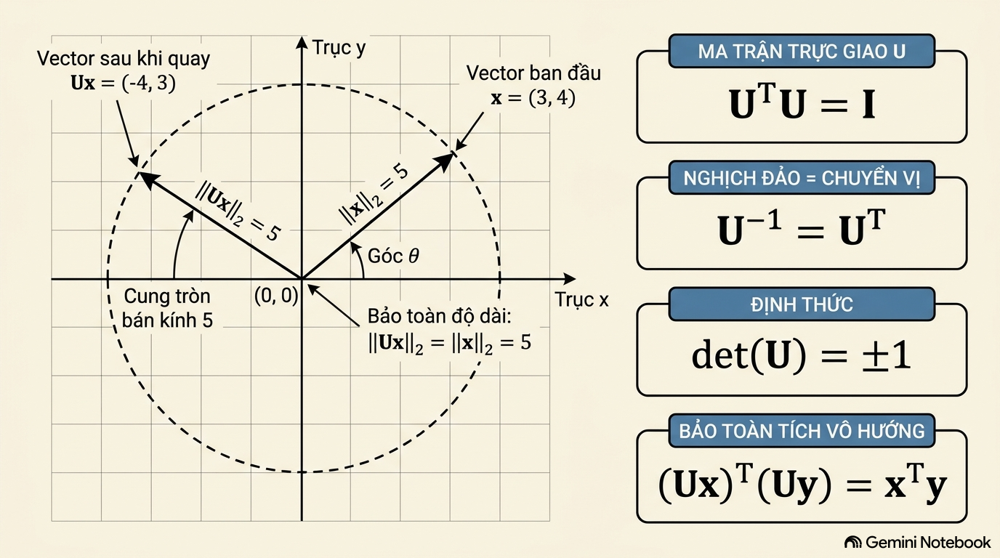

# Liên hệ hệ trực chuẩn và ma trận trực giao với Machine Learning

Một hệ tìm kiếm lưu một vector đặc trưng (embedding) cho mỗi ảnh. Khi có ảnh
truy vấn, hệ trả về ảnh có embedding gần nhất. Nếu ta quay toàn bộ các vector,
ảnh đứng đầu có đổi không? Nếu chỉ giữ một chiều để giảm dung lượng thì sao?
Ta sẽ tính điểm cho ba ảnh để trả lời hai câu hỏi đó.

Tài liệu đi kèm gồm [lý thuyết Bài 07](notes.md) và
[notebook thực hành NumPy](practice.ipynb).

## 1. Đọc phép quay trong hình minh họa



Ma trận $U=\begin{bmatrix}0&-1\\1&0\end{bmatrix}$ quay một phần tư vòng
ngược chiều kim đồng hồ. Vector truy vấn $x=(3,4)^T$ đi tới $Ux=(-4,3)^T$.
Hai đầu mút nằm trên cùng đường tròn vì $3^2+4^2=(-4)^2+3^2=25$.
Nhân $U^T$ với kết quả đưa truy vấn về vị trí ban đầu.

Hình còn cho biết $(Ux)^T(Uy)=x^Ty$. Điều này liên quan trực tiếp đến hệ
tìm kiếm vì $\|x-y\|_2^2=x^Tx+y^Ty-2x^Ty$. Nếu **cùng** quay cả truy vấn
lẫn từng ảnh trong kho, cả ba số ở vế phải đều giữ nguyên. Ta có thể dự đoán
toàn bộ thứ hạng khoảng cách trước khi chạy một dòng code.

## 2. Lập một bảng kết quả có thể kiểm tra bằng tay

Giả sử kho có ba ảnh A, B, C với embedding hai chiều như bảng dưới. Các giá trị
được chọn để có thể tính tay, mỗi embedding và cả truy vấn đều có độ dài 5.
Với truy vấn $(3,4)^T$, tìm láng giềng Euclid tương đương với chọn bình phương
khoảng cách nhỏ nhất vì phép lấy căn giữ thứ tự.

| Ảnh | Embedding $e$ | $\|e-x\|_2^2$ | $e^Tx$ | Cosine |
|---|---|---:|---:|---:|
| A | $(4,3)^T$ | 2 | 24 | 0,96 |
| B | $(0,5)^T$ | 10 | 20 | 0,80 |
| C | $(-3,4)^T$ | 36 | 7 | 0,28 |

Cả hai cách xếp hạng đều chọn A. Trong bảng này các ứng viên có cùng chuẩn.
Với các vector có chuẩn khác nhau, khoảng cách Euclid và cosine có thể xếp
thứ tự khác nhau. Phép quay vẫn bảo toàn từng loại điểm khi áp dụng đồng bộ,
vì nó giữ cả dot product lẫn chuẩn của mỗi vector. Cosine yêu cầu hai norm khác zero.

```python
import numpy as np

names = np.array(["A", "B", "C"])
E = np.array([[4., 3.], [0., 5.], [-3., 4.]])    # (3, 2), mỗi hàng một ảnh
x = np.array([3., 4.])                             # (2,), một truy vấn
U = np.array([[0., -1.], [1., 0.]])               # (2, 2)

def squared_distances(items, query):
    return np.sum((items - query) ** 2, axis=1)    # (số ảnh,)

dist2 = squared_distances(E, x)
cosine = (E @ x) / (np.linalg.norm(E, axis=1) * np.linalg.norm(x))
np.testing.assert_allclose(dist2, [2., 10., 36.])
np.testing.assert_allclose(cosine, [.96, .80, .28])
assert names[np.argmin(dist2)] == "A"
```

## 3. Quay cả kho và truy vấn trong cùng một hệ

Trong công thức $Ue$, $e$ là vector cột. Trong mảng $E$ của Bài 01, mỗi ảnh
chiếm một hàng. Chuyển vị công thức cho một ảnh được $(Ue)^T=e^TU^T$,
nên ta nhân cả bảng với $U^T$ bên phải.

| Phép tính | Shape kết quả | Ý nghĩa |
|---|---|---|
| `U @ x` | `(2,)` | Một truy vấn sau phép quay |
| `E @ U.T` | `(3, 2)` | Ba ảnh sau cùng phép quay |
| `E @ E.T` | `(3, 3)` | Tích vô hướng của mọi cặp ảnh |
| `E @ x` | `(3,)` | Điểm dot product của truy vấn với từng ảnh |

```python
E_rot = E @ U.T
x_rot = U @ x
np.testing.assert_allclose(E_rot[0], U @ E[0])       # phép quay của một ảnh
np.testing.assert_allclose(x_rot, [-4., 3.])
np.testing.assert_allclose(E_rot @ E_rot.T, E @ E.T)
np.testing.assert_allclose(E_rot @ x_rot, E @ x)
np.testing.assert_allclose(squared_distances(E_rot, x_rot), dist2)
np.testing.assert_allclose(E_rot @ U, E)              # hoàn tác cả kho
```

Ảnh A đi tới $(-3,4)^T$. Khoảng cách bình phương đến truy vấn mới $(-4,3)^T$
vẫn là $1^2+1^2=2$. Nếu hệ chỉ quay truy vấn mà tiếp tục dùng chỉ mục chứa
embedding cũ, chính ảnh C ở $(-3,4)^T$ sẽ có điểm này và đứng đầu.

```python
mixed_dist2 = squared_distances(E, x_rot)
np.testing.assert_allclose(mixed_dist2, [64., 20., 2.])
assert names[np.argmin(mixed_dist2)] == "C"
```

Lỗi này vẫn qua được kiểm tra shape và kiểm tra chuẩn từng vector. Một kiểm
tra tích hợp tốt là giữ một truy vấn đã biết cùng khoảng cách đến vài ảnh,
rồi tính lại các khoảng cách sau khi cập nhật cả bộ mã hóa truy vấn và chỉ mục.

## 4. Nén xuống ít chiều bằng phép chiếu

Chi phí lưu một kho dày gồm $N$ embedding $d$ chiều tỉ lệ với $Nd$. Giữ $k<d$
tọa độ theo basis trực chuẩn $Q$ chỉ cần $Nk$ giá trị cho kho và $dk$ cho basis
chung. Thử giữ riêng hướng thẳng đứng $q=(0,1)^T$. Khi đó mỗi ảnh chỉ cần một
tọa độ là độ cao của nó. Dữ liệu ba ảnh cho phép nhìn rõ cái giá phải trả.

```python
Q = np.array([[0.], [1.]])           # (2, 1), một hướng đơn vị
encoded = E @ Q                      # (3, 1), tọa độ theo hướng dọc
query_code = x @ Q                   # (1,)
restored = encoded @ Q.T             # (3, 2), các chân đường vuông góc
residual = E - restored
np.testing.assert_allclose(residual @ Q, 0., atol=1e-12)
compressed_dist2 = squared_distances(encoded, query_code)
np.testing.assert_allclose(compressed_dist2, [1., 1., 0.])
assert names[np.argmin(compressed_dist2)] == "C"
```

Truy vấn và ảnh C có cùng độ cao 4, còn toàn bộ khoảng cách giữa chúng nằm
trên trục ngang. Khi bỏ chiều ngang, hai điểm trùng nhau. A và B cũng đồng
hạng ở khoảng cách 1. Phần dư của từng ảnh cho biết nội dung tọa độ nào đã
mất. Để giải thích thay đổi thứ hạng, xét phần dư của **hiệu hai embedding**.

Với $\delta=e-x$ và $P=QQ^T$, định lý Pythagore cho

$$
\|\delta\|_2^2=\|Q^T\delta\|_2^2+\|(I-P)\delta\|_2^2.
$$

Khoảng cách sau nén luôn nhỏ hơn hoặc bằng khoảng cách gốc. Từng cặp mất
một lượng khác nhau, nên ứng viên gần nhất có thể đổi. Nếu mọi hiệu
$e-x$ đều ở trong span của $Q$, mọi khoảng cách truy vấn–ảnh được giữ nguyên.
Trong ví dụ, khoảng cách bình phương đến C giảm 36 còn đến A chỉ giảm 1.

## 5. Chọn basis và đánh giá trên truy vấn

Giả sử nhóm có vài hướng đặc trưng muốn giữ lại. Xếp chúng vào các cột của $B$
và dùng QR rút gọn để lấy $Q$ khi $B$ có full column rank. Khi ấy
`E @ Q` đo mỗi ảnh theo các trục vuông góc. QR tạo basis cho đúng span đã
chọn. Chất lượng tìm kiếm phụ thuộc vào span ấy và vào các truy vấn thực tế.
Nếu hướng được học từ dữ liệu, hãy fit trên tập train rồi dùng cùng basis
để mã hóa kho ảnh và truy vấn đánh giá.

Một cách đo tác động của nén là tính **tỷ lệ truy vấn giữ nguyên top-1** so
với tìm kiếm trong không gian đầy đủ. Chỉ số này đo mức tái hiện hệ ban đầu.
Để biết ảnh trả về có phù hợp với người dùng hay không, cần thêm nhãn liên
quan truy vấn–ảnh. Với điểm đồng hạng, cần quy ước xử lý nhất quán.

```python
queries = np.array([[3., 4.], [0., 5.]])              # (2, 2)
def nearest_ids(items, batch):
    differences = batch[:, None, :] - items[None, :, :]  # (truy vấn, ảnh, chiều)
    return np.argmin(np.sum(differences ** 2, axis=2), axis=1)

base_ids = nearest_ids(E, queries)
rotated_ids = nearest_ids(E_rot, queries @ U.T)
compressed_ids = nearest_ids(encoded, queries @ Q)
np.testing.assert_array_equal(names[base_ids], ["A", "B"])
np.testing.assert_array_equal(rotated_ids, base_ids)
np.testing.assert_array_equal(names[compressed_ids], ["C", "B"])
assert np.mean(compressed_ids == base_ids) == 0.5
```

Ở đây mỗi truy vấn có một ứng viên đứng đầu duy nhất. Phép quay giữ cả hai
kết quả. Phép chiếu chỉ giữ kết quả của truy vấn thứ hai. Tỷ lệ $1/2$ là kết
quả của bộ ví dụ nhỏ này. Với kho lớn, có thể xử lý theo từng nhóm truy vấn và
ảnh để giới hạn kích thước mảng ba chiều.

## 6. Checklist debug hệ tìm kiếm embedding

1. Xác nhận phép biến đổi cần áp dụng cho một vector. Đối chiếu một hàng của batch với phép tính đó.
2. Kiểm tra `U.T @ U` và khoảng cách của cùng cặp truy vấn–ảnh trước và sau phép quay.
3. Đảm bảo chỉ mục và truy vấn dùng cùng ma trận, thứ tự feature và bước tiền xử lý.
4. Khi nén, kiểm tra số chiều giữ lại, tính trực chuẩn của basis và chuẩn của phần dư.
5. So sánh top-1 trên cùng các truy vấn. Xem lại từng cặp gần đồng hạng nếu thứ tự nhạy với sai số số học.

## 7. Bài tập liên hệ

1. Thay $U$ bằng $\operatorname{diag}(-1,1)$. Dự đoán embedding mới của B,
   định thức và ảnh đứng đầu trước khi chạy code.
2. Với cùng $E,x$, thay hướng dọc bằng $q=(1,0)^T$. Tính ba khoảng cách
   bình phương sau nén. Lần này ảnh nào đứng đầu?
3. Từ hai bảng điểm `dist2` và `compressed_dist2`, tính lượng khoảng cách
   bình phương bị mất cho từng ảnh. Kiểm tra bằng hiệu tọa độ ngang.
4. Đổi sang ma trận $\operatorname{diag}(2,1/2)$. Kiểm tra định thức, ma trận
   Gram và khoảng cách giữa truy vấn với A. Giải thích phép kiểm tra nào phát hiện biến dạng.
5. Trong bài tổng hợp của notebook, chiếu một kho embedding ba chiều lên mặt
   phẳng. Với truy vấn đổi láng giềng, tìm cặp điểm có hiệu nằm hoàn toàn theo hướng bị bỏ.

## Tổng kết

Kho và truy vấn có thể cùng quay hoặc phản xạ mà vẫn giữ nguyên các điểm
Euclid và cosine. Với phép chiếu, mỗi cặp mất đúng phần khoảng cách do các
hướng bị bỏ đóng góp. Đo phần dư cho biết vì sao một cặp tiến lại gần nhau,
còn so thứ hạng trên các truy vấn cho biết sự thay đổi đó ảnh hưởng đến ảnh trả về.
