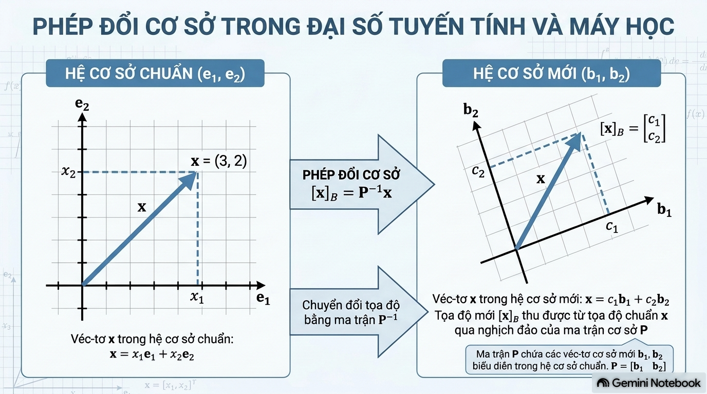

# Liên hệ đổi cơ sở và phép xoay với Machine Learning

Hai cảm biến đặt trong cùng một phòng thường nóng lên hoặc nguội đi cùng nhau.
Người vận hành muốn theo dõi cả nhiệt độ chung lẫn những lúc hai cảm biến đọc
lệch nhau. Nếu chỉ được lưu một số cho mỗi lần đo, PCA sẽ ưu tiên tín hiệu
nào? Ta dùng bốn lần đo để tự tìm câu trả lời, rồi kiểm tra trên ba mẫu mới.

Tài liệu đi kèm gồm [lý thuyết Bài 08](notes.md) và
[notebook thực hành NumPy](practice.ipynb).

## 1. Đọc phép đổi cơ sở trong hình



Hình gọi ma trận cơ sở là $P=[b_1\;b_2]$. Mũi tên ở hai khung biểu diễn cùng
một vector. Ta có thể kiểm tra mọi cặp tọa độ đề xuất bằng cách ghép lại
$c_1b_1+c_2b_2$ và so với $(3,2)^T$. Chẳng hạn, nếu **chọn**
$b_1=(1,0)^T$, $b_2=(1,1)^T$ như trong notes, cặp hệ số phải là $(1,2)^T$.
Hình minh họa việc đổi trục nói chung. Với phân tích thành phần chính
(principal component analysis, PCA), ta còn phải chọn gốc và học hướng trục
từ các mẫu train.

## 2. Tính tay hai đặc trưng từ bốn lần đo

Hai cột dưới đây là nhiệt độ trái và phải, cùng tính bằng °C. Mỗi cột có
trung bình 18. Lấy gốc $\mu=(18,18)$ rồi chọn hai hướng đơn vị
$q_1=(1,1)^T/\sqrt{2}$ và $q_2=(-1,1)^T/\sqrt{2}$. Hai trục là hai cột
của $Q$. Chiếu vector đã trừ trung bình lên từng trục để lấy hai tọa độ
$z_j=(x-\mu)^Tq_j$ (ở đây coi $x,\mu$ là vector cột cho một mẫu).

| Lần đo | Trái, phải (°C) | Sau khi trừ trung bình | $z_1$ | $z_2$ |
|---|---|---|---:|---:|
| A | $(16,16)$ | $(-2,-2)$ | $-2\sqrt{2}$ | $0$ |
| B | $(20,20)$ | $(2,2)$ | $2\sqrt{2}$ | $0$ |
| C | $(17,19)$ | $(-1,1)$ | $0$ | $\sqrt{2}$ |
| D | $(19,17)$ | $(1,-1)$ | $0$ | $-\sqrt{2}$ |

Ở lần C, nhiệt độ trung bình của cặp vẫn là 18 °C, nhưng cảm biến phải cao
hơn trái 2 °C. Ta đọc lại hai đại lượng có ý nghĩa vận hành bằng
$18+z_1/\sqrt{2}$ cho nhiệt độ trung bình và $\sqrt{2}z_2$ cho chênh lệch
phải trừ trái. Giữ cả hai tọa độ thì khôi phục được từng số đo.

## 3. Vì sao PCA chọn hai trục này?

Với $n$ mẫu đã trừ trung bình, phương sai mẫu dọc hướng đơn vị $q$ là
$\|X_c q\|_2^2/(n-1)$. Từ bảng trên, tổng bình phương hai cột tọa độ lần
lượt là 16 và 4. Tổng các tích $z_1z_2$ bằng 0. Vì vậy, với bất kỳ hướng
đơn vị $q=a q_1+b q_2$, phương sai bằng $(16a^2+4b^2)/3$, với $a^2+b^2=1$.
Giá trị lớn nhất đạt được khi $b=0$. Trục đầu của PCA do đó nằm dọc hướng
cả hai cảm biến cùng tăng. Nó giải thích $16/(16+4)=80\%$ phương sai train.

Với dữ liệu lớn hơn, dùng SVD như ở Bài 06. Từ $X_c=U\Sigma V^T$, các cột
của $V$ cho các hướng PCA, còn $\sigma_j^2/(n-1)$ là phương sai trên trục
thứ $j$. Trong ví dụ $n=4$, $d=2$ nên SVD rút gọn vẫn trả về đủ hai trục.

```python
import numpy as np

X_train = np.array([[16., 16.], [20., 20.], [17., 19.], [19., 17.]])
mu = X_train.mean(axis=0)                          # (2,), một trung bình mỗi cảm biến
Xc = X_train - mu                                  # (4, 2)
_, s, Vt = np.linalg.svd(Xc, full_matrices=False)
Q = Vt.T                                           # (2, 2), một trục mỗi cột
Z = Xc @ Q                                         # (4, 2), một lần đo mỗi hàng
variance = s**2 / (len(X_train) - 1)
ratio = s**2 / np.sum(s**2)

np.testing.assert_allclose(Q.T @ Q, np.eye(2), atol=1e-12)
np.testing.assert_allclose(Z.T @ Z / 3, np.diag(variance), atol=1e-12)
np.testing.assert_allclose(variance, [16/3, 4/3])
np.testing.assert_allclose(ratio, [.8, .2])
np.testing.assert_allclose(Z @ Q.T + mu, X_train)
```

SVD có thể trả về $-q_1$ thay cho $q_1$. Khi đó cả cột tọa độ tương ứng đổi
dấu, còn tích dùng để tái tạo giữ nguyên. Để so hướng học được với hướng tính
tay, so $|q_{\rm tay}^Tq_{\rm SVD}|$ với 1. Nếu triển khai một mô hình đã
học trên các tọa độ ấy, lưu đúng ma trận $Q$ cùng với $\mu$.

## 4. Giữ một chiều và đo phần bị mất trên dữ liệu mới

Khi giữ một trục, mỗi lần đo chỉ còn một tọa độ. Để đổi về °C, nhân tọa độ
với hướng đã giữ rồi cộng trung bình train. Trong ví dụ, với đầu vào $(a,b)$
ta dựng được $(m,m)$ với $m=(a+b)/2$. Vì thế cặp $(19,19)$ và cặp $(17,21)$
cùng cho kết quả tái tạo $(19,19)$.

| Mẫu mới (°C) | Dựng lại với một trục (°C) | Phần dư (gốc trừ dựng lại) | MSE trên hai cảm biến (°C²) |
|---|---|---|---:|
| $(19,19)$ | $(19,19)$ | $(0,0)$ | 0 |
| $(17,21)$ | $(19,19)$ | $(-2,2)$ | 4 |
| $(20,18)$ | $(19,19)$ | $(1,-1)$ | 1 |

```python
X_new = np.array([[19., 19.], [17., 21.], [20., 18.]])
Q1 = Q[:, :1]                                      # (2, 1), giữ trục cột
codes = (X_new - mu) @ Q1                          # (3, 1)
restored = codes @ Q1.T + mu                       # (3, 2)
residual = X_new - restored
mse = np.mean(residual**2, axis=1)                 # (3,), một sai số mỗi lần đo

np.testing.assert_allclose(restored, [[19., 19.]] * 3)
np.testing.assert_allclose(mse, [0., 4., 1.], atol=1e-12)
np.testing.assert_allclose(residual @ Q1, 0., atol=1e-12)
```

Sai số bình phương trung bình của một cặp là $(a-b)^2/4$. Mẫu thứ hai có
MSE cao nhất vì hai số đo cách nhau 4 °C. Nếu chỉ lưu `codes`, cả ba mẫu
nhận cùng mã. Nếu mục tiêu là phát hiện hai cảm biến bất đồng, có thể tính
và lưu chênh lệch ngay lúc nhận mẫu, hoặc giữ thêm tọa độ thứ hai. Phần dư
lớn xác định được một cặp cần xem lại. Muốn kết luận cảm biến nào lệch chuẩn
cần thêm phép đo tham chiếu.

## 5. Chọn và dùng cùng hệ tọa độ khi triển khai

- **Fit trên train.** Tính $\mu,Q$ từ những lần đo dùng để học. Khi có mẫu
  mới, áp dụng đúng $\mu,Q$, cùng thứ tự cột và cùng đơn vị. Nếu trừ trung
  bình của riêng một batch chỉ có một hàng, cả hai tọa độ đều bằng 0.
- **Chọn số trục theo công việc.** Mục tiêu nhiệt độ trung bình và mục tiêu
  phát hiện chênh lệch cần hai loại thông tin khác nhau. So sai số tái tạo
  hoặc chất lượng phát hiện trên tập validation theo từng giá trị $k$. Con số
  80% ở trên chỉ mô tả phương sai của bốn lần đo dùng để học.
- **Kiểm tra đơn vị.** Nếu đổi riêng cột phải từ °C sang °F, trừ trung bình
  sẽ loại phần dịch 32 nhưng độ dao động của cột đó vẫn tăng 1,8 lần.
  PCA khi ấy tối ưu phương sai trong một thang đo khác. Với hai nhiệt kế,
  hãy quy về cùng đơn vị vật lý trước khi học cơ sở.

## 6. Checklist debug PCA

1. In shape của $X$, $\mu$, $Q_k$ và $Z_k$. Kiểm tra trên một hàng rằng phép nhân batch cho cùng kết quả với công thức vector cột.
2. Kiểm tra trung bình theo cột của $X_c$ trên train, rồi kiểm tra $Q_k^TQ_k=I_k$.
3. Giữ đủ hai trục và thử tái tạo một mẫu mới. Bước này phát hiện lỗi thứ tự nhân hoặc quên cộng $\mu$.
4. Giữ một trục và tính cả sai số theo từng mẫu lẫn phần dư có dấu trên từng cảm biến. So cặp đáng chú ý với số đo gốc.

## 7. Bài tập liên hệ

1. Tính $z_1,z_2$ của $(15,21)$ theo hai hướng ở mục 2. Nếu chỉ lưu $z_1$, mẫu được dựng lại ở đâu? MSE bằng bao nhiêu?
2. Thay $q_2$ bằng $-q_2$. Số nào trong bảng ở mục 2 đổi dấu? Dùng lần đo C để kiểm tra phép giải mã.
3. Một thiết bị báo động khi độ chênh tuyệt đối vượt 3 °C. Dùng bảng ở mục 4 để chọn các mẫu cần báo động. Viết lại điều kiện này theo MSE, rồi thử với cặp có độ chênh đúng 3 °C.
4. Trong bài tổng hợp của notebook, ba cảm biến cùng đo một phòng. Thử tăng đồng thời mọi số đo mới thêm 5 °C. Dự đoán sự thay đổi của tọa độ trên trục chung, giá trị tái tạo và phần dư.

## Tổng kết

Ở bộ dữ liệu này, trục PCA thứ nhất đo xu hướng nóng lên chung, trục thứ hai
đo độ lệch giữa hai nhiệt kế. Đổi sang đủ hai trục vẫn cho phép đọc lại từng
nhiệt độ. Khi chỉ giữ một trục, một cặp lệch nhau 4 °C có thể nhận đúng
mã của hai nhiệt kế đang đồng thuận. Kiểm tra cả tọa độ giữ lại lẫn phần dư
giúp quyết định một cách nén có phù hợp với phép đo cần theo dõi hay không.
